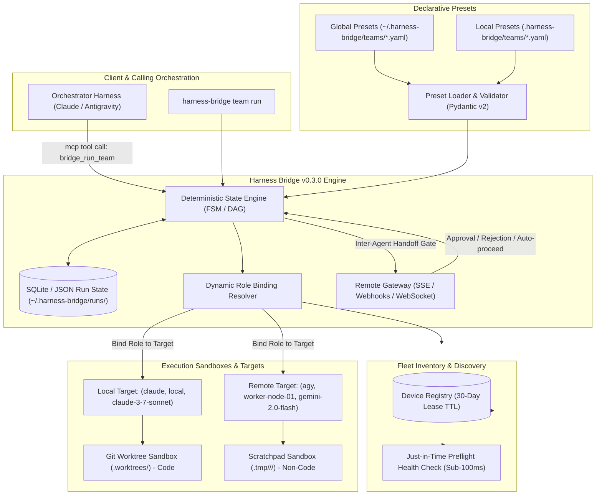
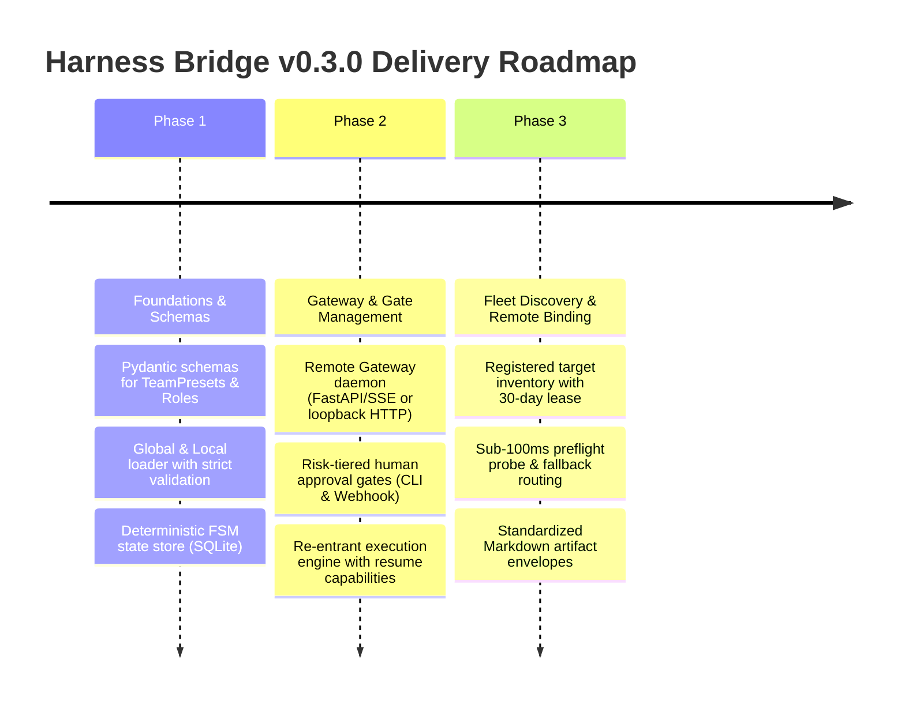

# Concept Brief: Declarative Role & Team Preset Framework (Harness Bridge v0.3.0)

* **Author:** Sukumar Rastogi
* **Synthesizer:** EGM Synthesizer Persona
* **Mode:** BRAINSTORM
* **Date:** 2026-11-12
* **Status:** Ready for Architecture Review & RFC Drafting

---

## 1. Executive Summary & Vision

Harness Bridge v0.1.0 and v0.2.0 successfully solved the single-turn and multi-turn execution bridging problem between disparate CLI harnesses (`claude`, `agy`) running on local machines, introducing git worktree sandboxing, stdio JSON-RPC MCP framing, and recursion loop limiters.

**Harness Bridge v0.3.0** elevates the system from a point-to-point harness proxy into a **declarative, multi-agent coordination bus**. By introducing **Team Presets** and **Role Specifications** authored in portable YAML (globally in `~/.harness-bridge/teams/` and locally in `.harness-bridge/teams/`), coordination topologies are decoupled from concrete physical nodes and specific harness installations.

Execution is driven by a **hybrid deterministic state engine** coupled with calling-session orchestration, dynamically binding logical roles (`architect`, `coder`, `reviewer`, `researcher`) to registered `(harness, device_id, model)` execution targets. Handoffs support **Remote Gateway human-in-the-loop approval gates** with configurable auto-proceed fallbacks, isolated `.tmp/` scratch spaces for rapid iteration, and standardized Markdown report artifacts for non-code and conceptual deliverables. Comprehensive **token telemetry and accounting** tracks token consumption and percentage allocations both per-role and per-session across the entire team lifecycle.

---

## 2. Reviewer Status Table

| Reviewer Shortname | Brainstorming Role Lens | Status | Key Focus Area |
| :--- | :--- | :--- | :--- |
| `egm-design` | Skeptical Architect & UX Brainstormer | **completed** | Ergonomics, auto-proceed safety anti-patterns, CLI surface |
| `egm-codebase-details` | Codebase Details Brainstormer | **completed** | `SessionManager`, `WorkspaceManager`, stdio framing, persistence |
| `egm-zoom-out` | Strategic & Ecosystem Brainstormer | **completed** | Fleet orchestration, multi-device failure domains, market fit |
| `egm-comprehension` | Comprehension & Cognitive Brainstormer | **completed** | Mental models, terminology collision, 30-day TTL clarity |
| `egm-implementation-readiness` | Implementation & Protocols Brainstormer | **completed** | State transitions, re-entrancy, handoff envelopes, network RPC |
| `egm-structural` | Structural & Data Architecture Brainstormer | **completed** | YAML schema, directory hierarchy, validation models, config precedence |
| `egm-inventive-catalyst` | Inventive Catalyst (TRIZ) Brainstormer | **completed** | Contradiction resolution, speculative execution, capability matrices |

---

## 3. System Architecture & Coordination Topology



---

## 4. Declarative Schema Specification

Team presets decouple the *workflow topology* (roles, steps, conditions, handoffs) from the *physical environment* (host, harness binary, model).

### Example Team Preset: `software-feature-swarm.yaml`
```yaml
schema_version: "0.3.0"
team_name: "feature-delivery-team"
description: "Three-agent iterative pipeline for architectural review, implementation, and verification"

roles:
  architect:
    description: "Evaluates requirements, designs interface contracts, and drafts architectural blueprints"
    capabilities:
      - "code_read"
      - "markdown_synthesis"
    preferred_harness: "claude"
    preferred_model: "claude-3-7-sonnet"
    workspace_mode: "inherit"

  engineer:
    description: "Implements code modifications and generates unit tests"
    capabilities:
      - "git_worktree"
      - "terminal_execution"
    preferred_harness: "claude"
    preferred_model: "claude-3-7-sonnet"
    workspace_mode: "worktree"

  verifier:
    description: "Runs test suites, audits static analysis, and prepares markdown review reports"
    capabilities:
      - "terminal_execution"
      - "markdown_synthesis"
    preferred_harness: "agy"
    preferred_model: "gemini-2.0-flash"
    workspace_mode: "worktree"

workflow:
  initial_role: "architect"
  scratch_directory: ".tmp/harness-bridge/{run_id}/"

  steps:
    - id: "spec_design"
      role: "architect"
      prompt_template: "Design feature specification and draft implementation plan for: {task_prompt}"
      artifact_output: "{scratch_directory}/spec.md"
      transitions:
        - condition: "success"
          next_step: "gate_architecture_approval"

    - id: "gate_architecture_approval"
      type: "human_approval_gate"
      prompt: "Review proposed architectural specification at {scratch_directory}/spec.md before code generation begins."
      gate_policy:
        timeout_seconds: 120
        timeout_action: "proceed" # Configurable: proceed | reject | pause
        risk_level: "low"
      transitions:
        - condition: "approved"
          next_step: "code_implementation"
        - condition: "rejected"
          next_step: "spec_design"

    - id: "code_implementation"
      role: "engineer"
      prompt_template: "Implement code changes conforming to {scratch_directory}/spec.md."
      transitions:
        - condition: "success"
          next_step: "verification_audit"
        - condition: "failure"
          next_step: "gate_failure_intervention"

    - id: "verification_audit"
      role: "verifier"
      prompt_template: "Run pytest and inspect diff. Produce markdown report at {scratch_directory}/verification_report.md."
      artifact_output: "{scratch_directory}/verification_report.md"
      transitions:
        - condition: "tests_passed"
          next_step: "gate_final_merge"
        - condition: "tests_failed"
          next_step: "code_implementation"

    - id: "gate_final_merge"
      type: "human_approval_gate"
      prompt: "Verification passed. Approve git branch diff application into mainline repository."
      gate_policy:
        timeout_seconds: 0 # 0 = Strict blocking (no auto-proceed allowed for mutations)
        timeout_action: "pause"
        risk_level: "critical"
```

---

## 5. Multi-Lens Brainstorming Findings (Prioritized)

### 🔴 Blocker Considerations (Critical Architectural & Safety Hazards)

#### 1. Unsafe Default 120-Second Auto-Proceed for Destructive Actions (`egm-design`, `egm-implementation-readiness`)
* **Finding**: A blanket 120-second auto-proceed default on human approval gates is a severe safety hazard. If an agent workflow reaches a gate that applies diffs, commits code, drops databases, or accesses production APIs, unattended timeouts will automatically trigger irreversible side effects.
* **Impact**: Defeats the foundational premise of human-in-the-loop safety. A user stepping away from their desk for 3 minutes returns to find unwanted changes merged or executed.
* **Resolution**: Introduce **Risk-Tiered Gate Policies**.
  * `read_only` / `exploratory` gates: Can safely default to auto-proceed after 120s.
  * `mutation` / `destructive` gates (git merge, network deploy, shell command execution): Must enforce **Strict Blocking** (`timeout_seconds: 0` or default to `pause/suspend`).
  * Add a global CLI flag: `--require-explicit-approvals` to disable all auto-proceed timers globally.

#### 2. Process Lifecycle & State Loss in Stdio MCP Servers (`egm-codebase-details`, `egm-structural`)
* **Finding**: Harness Bridge currently runs as a stdio child process attached to an orchestrator session (e.g. spawned by Claude Code). In-memory state in `SessionManager` evaporates if the client session terminates, crashes, or restarts. A team workflow executing across hours or pausing at a human gate cannot rely on in-memory Python structures.
* **Impact**: Total loss of running team states during human gate wait periods; orphaned background processes.
* **Resolution**: Implement a lightweight, persistent state store (`SQLite` with WAL mode or atomic JSON state journal in `~/.harness-bridge/runs/<run_id>.json`). The state engine must be fully **re-entrant**: any worker or CLI command (`harness-bridge team resume <run_id>`) can reconstruct the exact FSM state.

#### 3. Semantic Drift in 30-Day TTL vs Active Liveness (`egm-comprehension`, `egm-zoom-out`)
* **Finding**: The concept specifies "automatic MCP pings with 30-day TTLs". In distributed systems, a 30-day TTL represents a *registration cache lease*, whereas a "ping" implies *real-time reachability*. Binding a role to a device simply because it pinged 25 days ago will fail 90% of the time if laptops sleep, IPs change, or local harnesses are closed.
* **Impact**: High failure rates during dynamic binding; confusing timeouts for users.
* **Resolution**: Decouple into two explicit concepts:
  1. **Device Registry Lease (30-day TTL)**: Retains known device identities, public keys, and capability profiles without requiring re-pairing.
  2. **Just-in-Time Preflight Probe (Sub-100ms Ping)**: Before dispatching a task to a registered target, the engine sends a lightweight health probe. If unacknowledged within 1500ms, the engine marks the target *temporarily unreachable* and falls back to secondary candidates.

---

### 🟡 Major Considerations (Architecture, Coordination & Ergonomics)

#### 4. Topological Portability vs Harness Leaks (`egm-design`, `egm-structural`)
* **Finding**: YAML presets claim to decouple topologies from physical hardware, but prompts frequently leak harness-specific assumptions (e.g., instructing the agent to run Claude-specific slash commands `/review` or Antigravity-specific internal memory hooks).
* **Impact**: Portability fails when a role bound to Claude is executed on Antigravity, leading to syntax errors or prompt degradation.
* **Resolution**: Introduce **Harness Normalization Adapters** and **System Prompt Injections** in drivers. Presets should define tasks using neutral intent directives, and the driver translates them into harness-native context envelopes.

#### 5. Scratch Space Lifecycle and Mainline Repository Pollution (`egm-codebase-details`, `egm-structural`)
* **Finding**: Using `.tmp/` inside the local repository for scratch spaces risks polluting user git repositories, triggering accidental git commits of transient artifacts, or causing git status noise if `.tmp/` is not explicitly ignored.
* **Impact**: Dirty working trees; git checkout conflicts during worktree branch operations.
* **Resolution**: Store scratch spaces either:
  * Inside git-ignored `.harness-bridge/scratch/<run_id>/`, OR
  * In the OS temp directory (`/tmp/harness-bridge/<run_id>/` or `~/.harness-bridge/scratch/<run_id>/`), providing symbolic links or mounting into the target workspace only when required.
  * Automatically append `.tmp/` and `.harness-bridge/` to `.git/info/exclude` (local git exclusions without modifying project `.gitignore`).

#### 6. Gateway Architecture: Stdio vs Network Transport (`egm-codebase-details`, `egm-implementation-readiness`)
* **Finding**: The "Remote Gateway" for non-blocking human approval gates cannot run over stdio JSON-RPC because stdio is exclusively dedicated to the calling harness orchestrator.
* **Impact**: Port collisions, process deadlock, or protocol corruption if stdout/stderr are polluted.
* **Resolution**: Run the Remote Gateway as an independent daemon or embedded background asyncio server on a dedicated local loopback port (e.g., `http://127.0.0.1:4242` or Unix Domain Socket `~/.harness-bridge/gateway.sock`). Expose a REST/SSE endpoint for approval gate notifications, a lightweight web dashboard, and CLI integration (`harness-bridge gate approve <run_id>`).

#### 7. Preset Precedence & Extension Semantics (`egm-structural`, `egm-comprehension`)
* **Finding**: Presets exist globally (`~/.harness-bridge/teams/`) and locally (`.harness-bridge/teams/`). What happens when names collide? Does local completely override global, or do roles merge?
* **Impact**: Silent shadowing of team configurations leading to unexpected agent behavior.
* **Resolution**: Explicit precedence rule: **Local overrides Global entirely per team name**. If a team preset wants to extend a base preset, support an explicit `extends: "base-team"` syntax. Provide `harness-bridge team inspect <name>` showing the exact source file and resolved inheritance tree.

---

### 🟢 Ergonomic Nits & Opportunities (Polish & Quality-of-Life)

#### 8. Standardized Markdown Report Artifact Contracts (`egm-comprehension`, `egm-zoom-out`)
* **Opportunity**: For non-code workflows (e.g., research, document audit, competitive analysis), standardize artifact frontmatter:
  ```yaml
  ---
  report_type: "concept_brief"
  producer_role: "verifier"
  run_id: "7f3b8a2c"
  timestamp: "2026-11-12T01:30:00Z"
  status: "verified"
  ---
  ```
  This enables downstream agents and orchestrators to programmatically parse metadata without fuzzy regex scraping.

#### 9. Speculative Execution in Approval Gates (`egm-inventive-catalyst`)
* **Opportunity**: Rather than idling during the 120-second human gate window, the downstream worker can speculatively execute read-only preparations or branch computation in a temporary sandbox. If the human approves, output is instant; if rejected, the sandbox is wiped.

#### 10. CLI Team Discovery & Interactive TUI (`egm-design`)
* **Opportunity**: Add Rich-based terminal visualizers:
  * `harness-bridge team list`: Tabular list of available teams, roles, and source paths.
  * `harness-bridge team trace <run_id>`: Live ASCII DAG showing active role, current state, gate countdown, and artifact links.

#### 11. Granular Token Telemetry & Relative Usage Accounting (`egm-codebase-details`, `egm-design`)
* **Requirement**: The system must track input, output, and total token usage across two distinct aggregation dimensions:
  1. **Per-Role Accounting**: Aggregated across all sessions fulfilling a given role (e.g., `architect: 12,400 tokens (15.2%)`, `engineer: 54,800 tokens (67.1%)`, `verifier: 14,500 tokens (17.7%)`).
  2. **Per-Session Accounting**: Tracked individually for each concurrent or sequential session instance (e.g., `orch-1 (architect): 15.2%`, `impl-1 (engineer): 38.0%`, `impl-2 (engineer): 29.1%`, `verif-1 (verifier): 17.7%`).
* **Cross-Run Historical Analytics (`Role x Model` Benchmarks)**:
  * Users and orchestrators need visibility into historical benchmarks across runs, answering questions such as: *"What is the average token consumption of an `architect` role executing on `claude-3-7-sonnet` vs `gemini-2.0-flash`?"*
  * Supported analytical views:
    * `AVG(total_tokens)` grouped by `(role_name, model)` across all sampled sessions.
    * Input vs. Output token ratios per role archetype.
    * Percentiles (P50, P90) and session sample counts to detect prompt drift or regression.
* **Storage Schema (`~/.harness-bridge/runs.db`)**:
  ```sql
  CREATE TABLE token_telemetry (
      telemetry_id TEXT PRIMARY KEY,
      run_id TEXT NOT NULL,
      stage_id TEXT NOT NULL,
      session_id TEXT NOT NULL,
      role_name TEXT NOT NULL,
      harness TEXT NOT NULL,
      model TEXT NOT NULL,
      input_tokens INTEGER NOT NULL DEFAULT 0,
      output_tokens INTEGER NOT NULL DEFAULT 0,
      total_tokens INTEGER NOT NULL DEFAULT 0,
      timestamp REAL NOT NULL,
      FOREIGN KEY (run_id) REFERENCES team_runs(run_id)
  );

  CREATE INDEX idx_telemetry_role_model ON token_telemetry(role_name, model);
  ```
* **Surfacing Channels**:
  * **CLI**:
    * `harness-bridge team report <run_id>`: Live run breakdown by Role and Session.
    * `harness-bridge analytics tokens [--role <name>] [--model <name>]`: Cross-run historical benchmark table rendering average, min, max, and P90 tokens per session.
  * **Artifacts**: Automatically injected into the final team markdown deliverable frontmatter and telemetry appendix.
  * **MCP**:
    * `bridge_get_team_status`: Live run telemetry.
    * `bridge_get_token_analytics(role, model, window_days)`: Historical benchmark aggregates for planning and model routing decisions.
  * **Remote Gateway**: `GET /api/v1/analytics/tokens` endpoint for remote dashboards and mobile clients.

---

## 6. Inventive Synthesis & Contradiction Resolution (TRIZ Matrix)

Applying the 40 Inventive Principles of TRIZ to core systemic tensions in the v0.3.0 framework:

| Systemic Contradiction | Opposing Demands | TRIZ Principles Applied | Architectural Pattern Resolution |
| :--- | :--- | :--- | :--- |
| **Contradiction 1: Autonomy vs. Oversight** | Pipelines require uninterrupted autonomous speed, but human safety requires halting for gate approval. | **Principle 10 (Preliminary Action)**<br>**Principle 24 (Intermediary)** | **Shadow Speculative Execution & Risk-Tiered Classification**:<br>1. Non-destructive steps auto-proceed.<br>2. Destructive steps block strictly.<br>3. Downstream agent speculatively generates non-committal draft artifacts during the wait period. |
| **Contradiction 2: Hardware Decoupling vs. Specialization** | Team presets must be portable across arbitrary machines, but agents require exact hardware/model capabilities (e.g. CUDA GPU, specific LLM context window). | **Principle 1 (Segmentation)**<br>**Principle 28 (Replacement of Mechanical System)** | **Capability-Contract Binding**:<br>Roles never declare hardcoded machine names (`sukumar-desktop`). They declare *Capability Constraints* (`capabilities: [gpu, 128k_context]`). The Discovery Engine dynamically maps registered targets against the capability matrix. |
| **Contradiction 3: High Liveness vs. Low Overhead** | The orchestrator needs instant confidence that a target device is online, but continuous heartbeats waste network, battery, and compute. | **Principle 15 (Dynamism)**<br>**Principle 19 (Periodic Action)** | **Two-Tiered Hybrid Registry**:<br>30-Day static identity registration lease (persisted on disk) + opportunistic, just-in-time 50ms preflight TCP/MCP probe immediately before role handoff dispatch. |

---

## 7. Phased Implementation Roadmap



### Phase 1: Core Declarative Schema & State Engine (v0.2.5)
- Implement `harness_bridge.teams.models`: `TeamPreset`, `RoleSpec`, `WorkflowStep`, `GatePolicy`, `TokenAccounting`.
- Implement `harness_bridge.teams.loader`: Support `~/.harness-bridge/teams/` and `.harness-bridge/teams/`.
- Introduce persistent SQLite run logger & token telemetry store in `harness_bridge.teams.state`.

### Phase 2: Remote Gateway & Approval Gates (v0.2.8)
- Build the loopback HTTP/SSE Gateway server (`harness-bridge gateway start`).
- Implement human-in-the-loop approval gate state transitions with risk-tiered auto-proceed policies.
- CLI commands: `harness-bridge team run`, `harness-bridge team status`, `harness-bridge team report`, `harness-bridge analytics tokens`, `harness-bridge gate approve`.

### Phase 3: Dynamic Binding & Fleet Discovery (v0.3.0 Release)
- Implement MCP ping registration with 30-day lease storage and just-in-time health checks.
- Add remote harness dispatch over authenticated mTLS / WebSocket proxy.
- Implement MCP analytical queries: `bridge_get_token_analytics(role, model, window_days)`.
- Complete documentation, preset templates (`code-review`, `feature-dev`, `deep-research`), and end-to-end integration test suites.
