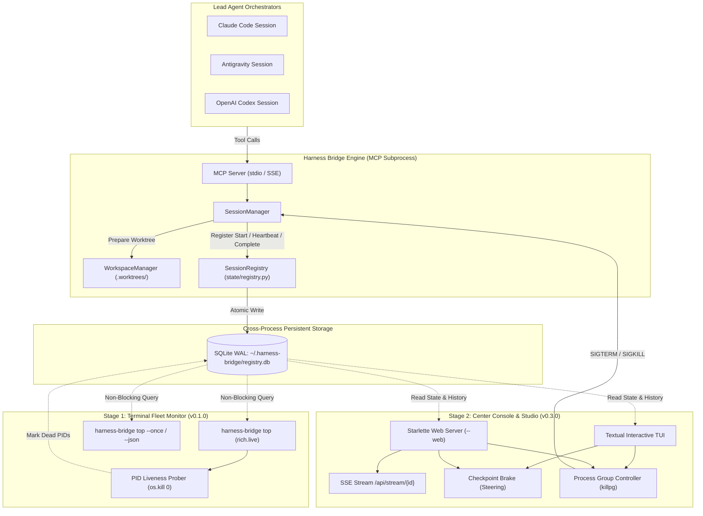

# Harness Bridge Center Console & Two-Stage Observability Suite

* **Author:** Sukumar Rastogi (`sukumar1210`)
* **Target Milestones:** `v0.1.0` (Stage 1: Terminal Fleet Monitor) & `v0.3.0` (Stage 2: Full Bidirectional Studio & Console)
* **Status:** Approved
* **Date:** 2026-11-15

---

## 1. The Problem

Harness Bridge enables disparate AI coding agents (Claude Code, Google Antigravity, OpenAI Codex CLI, OpenCode) to interoperate as orchestrators and workers executing code modifications inside isolated Git worktrees. However, running multi-agent workflows headlessly introduces significant operational challenges:

1. **The Headless Observability Vacuum**:
   When an orchestrating agent dispatches sub-turns to worker harnesses (`claude -p` or `agy -p`) across multiple isolated worktrees, the human operator has no visibility into what the worker agents are doing. Developers cannot see which turns are currently running, inspect stdout/stderr streams, evaluate token duration, or check whether an agent is making progress or stuck in an infinite prompt loop.
2. **Ungraceful Runaway Task Termination**:
   Currently, the only way to cancel a runaway background turn is to manually search through OS process tables (`ps aux | grep claude`) and issue manual `kill -9` commands. This risks killing unrelated processes, leaves orphaned Git worktrees on disk (`.worktrees/`), and causes database lock corruption.
3. **Multi-Agent Fleet Coordination Overhead**:
   As tasks scale from single-agent turns to coordinated multi-agent dialogues (such as Coordinated Dialogues between Claude and Codex, or P2P Mesh exploration swarms), tracking parent-child relationships between orchestrators and workers becomes unmanageable without a unified hierarchy display.

---

## 2. Overview

This specification establishes a **Two-Stage Observability Suite** for Harness Bridge:

```
┌────────────────────────────────────────────────────────────────────────┐
│ Stage 1: Milestone v0.1.0 - Terminal Fleet Monitor (harness-bridge top) │
│ • Zero new runtime dependencies (built on rich.live & rich.table)       │
│ • Cross-process SQLite WAL registry (~/.harness-bridge/registry.db)    │
│ • Read-only live terminal display (PIDs, harnesses, modes, durations)   │
│ • Proactive PID liveness checking & automated zombie process reaping   │
│ • Snapshot & CI support (--once, --json)                                │
└────────────────────────────────────────────────────────────────────────┘
                                    │
                                    ▼
┌────────────────────────────────────────────────────────────────────────┐
│ Stage 2: Milestone v0.3.0 - Full Bidirectional Studio & Center Console │
│ • Dual-Mode Hybrid: Textual TUI default + Starlette Web Dashboard     │
│ • Real-time stdout/stderr log streaming & live Git diff inspection     │
│ • Active process-group cancellation (SIGTERM/SIGKILL) & PID safety     │
│ • Checkpoint Brake: human-in-the-loop steering & prompt re-dispatch     │
│ • Pre-bundled static web assets (zero npm runtime dependencies)        │
└────────────────────────────────────────────────────────────────────────┘
```

* **Stage 1 (Milestone `v0.1.0`)**: Delivers `harness-bridge top` (alias `hb monitor`). It introduces a shared, cross-process SQLite database in WAL mode (`~/.harness-bridge/registry.db`) requiring zero external dependencies. The terminal interface renders an auto-refreshing table of active lead orchestrators and subordinate workers, showing turn counts, elapsed time, status spinners, and prompt previews.
* **Stage 2 (Milestone `v0.3.0`)**: Delivers `harness-bridge console`. It features an interactive Textual TUI alongside an embedded local web dashboard (`--web`). It provides active control: real-time streaming logs, syntax-highlighted diff viewer, single-key task cancellation (`os.killpg`), and a "Checkpoint Brake" allowing operators to inject human guidance into ongoing Coordinated Dialogues before patches are applied.

---

## 3. Goals & Non-Goals

### Goals

* **G-1: Zero-Dependency Terminal Monitoring (`v0.1.0`)**: Provide an auto-refreshing terminal command (`harness-bridge top`) using existing `rich.live` and standard library `sqlite3` in WAL mode, requiring zero new external packages.
* **G-2: Automated Zombie Reaping (`v0.1.0`)**: Automatically probe recorded worker PIDs on render ticks (`os.kill(pid, 0)`) and mark crashed or killed external processes as `CRASHED` or `ORPHANED` without manual database cleanup.
* **G-3: Scriptable Pipeline Observability (`v0.1.0`)**: Support `harness-bridge top --once` and `harness-bridge top --json` for headless CI jobs, automated scripts, and integration debugging.
* **G-4: Dual-Mode Interactive Studio (`v0.3.0`)**: Deliver `harness-bridge console` with a master-detail Textual TUI and an embedded Starlette/Uvicorn web dashboard (`--web`) streaming live Server-Sent Events (SSE).
* **G-5: Active Process Group Cancellation (`v0.3.0`)**: Enable single-key cancellation of running tasks via process-group signals (`os.killpg`), validating process creation times to prevent PID recycling accidents.
* **G-6: Human-in-the-Loop Dialogue Steering (`v0.3.0`)**: Introduce an interactive Checkpoint Brake allowing human operators to inspect uncommitted worktree diffs and inject course-correction prompts into live multi-turn dialogues.

### Non-Goals

* **NG-1: Web Dashboard in v0.1.0**: The browser-based interface is strictly deferred to Stage 2 (`v0.3.0`) to keep `v0.1.0` minimal, stable, and dependency-free.
* **NG-2: NPM Runtime Dependencies**: The embedded web dashboard must not require users to install Node.js or run `npm install`. All frontend assets must be pre-compiled into static distribution resources inside the Python package.
* **NG-3: Unauthenticated Public Network Exposure**: The web dashboard binds to loopback (`127.0.0.1`) by default, requiring explicit flags (`--host 0.0.0.0`) and bearer tokens for remote interface binding.

---

## 4. Technical Plan

### 4.1 System Architecture & Telemetry Pipeline



---

### 4.2 Component Architecture & Specifications

#### 1. Cross-Process Session Registry: `harness_bridge/state/registry.py` (New File - v0.1.0)
* **Storage Location**: `~/.harness-bridge/registry.db`.
* **Database Engine**: Python standard library `sqlite3` configured with:
  ```sql
  PRAGMA journal_mode = WAL;
  PRAGMA busy_timeout = 2000;
  PRAGMA synchronous = NORMAL;
  ```
* **Database Schema**:
  ```sql
  CREATE TABLE IF NOT EXISTS active_sessions (
      session_id TEXT PRIMARY KEY,
      orchestrator_pid INTEGER NOT NULL,
      worker_pid INTEGER,
      worker_start_time REAL,
      harness TEXT NOT NULL,
      workspace_mode TEXT NOT NULL,
      worktree_path TEXT,
      turn_number INTEGER NOT NULL DEFAULT 1,
      status TEXT NOT NULL,
      prompt_preview TEXT NOT NULL,
      start_time REAL NOT NULL,
      last_heartbeat REAL NOT NULL,
      end_time REAL,
      duration_seconds REAL,
      exit_code INTEGER,
      error_message TEXT
  );

  CREATE INDEX IF NOT EXISTS idx_sessions_status ON active_sessions(status);
  ```
* **Key Methods in `SessionRegistry`**:
  * `register_start(spec: TaskSpec, orchestrator_pid: int, worker_pid: int | None, worker_start_time: float | None) -> None`: Inserts or updates an active session row on turn initialization.
  * `update_heartbeat(session_id: str, turn_number: int) -> None`: Touches `last_heartbeat = time.time()` to prove liveness.
  * `register_complete(session_id: str, status: SessionStatus, duration: float, exit_code: int, error: str | None = None) -> None`: Sets `status`, `end_time`, `duration_seconds`, and `exit_code`.
  * `list_sessions(status: str | None = None, limit: int = 50) -> list[SessionRecord]`: Queries active or recent sessions using `PRAGMA query_only = ON;`.
  * `reap_stale_and_zombies() -> int`: Iterates over `status = 'running'` rows. Probes `worker_pid` and `orchestrator_pid` via `os.kill(pid, 0)`. If `ESRCH` (No such process), transitions the record to `CRASHED` or `ORPHANED`.

#### 2. Terminal Fleet Monitor: `harness_bridge/cli/top.py` (New File - v0.1.0)
* **Command Syntax**: `harness-bridge top [OPTIONS]` (alias: `harness-bridge monitor`).
* **CLI Options**:
  * `-i, --interval FLOAT`: Polling refresh interval in seconds (default `1.0`).
  * `-1, --once`: Output a single formatted snapshot table and exit (for scripts, CI, and pagers).
  * `--json`: Output active session snapshot as JSON to stdout.
  * `--all`: Include recently completed and failed sessions from the last 24 hours.
* **Rendering Engine**:
  * Built using `rich.live.Live` with `screen=True` (alt-screen buffer) and `auto_refresh=False`.
  * Renders a two-tier layout:
    * **Header Panel**: Product version, host OS, active orchestrators count, active workers count, total completed turns count.
    * **Fleet Table**: Columns for `PID`, `HARNESS` (colored badges: `claude` [Magenta], `agy` [Cyan], `codex` [Green], `opencode` [Blue]), `SESSION ID` (truncated 8-character UUID), `MODE` (`inherit` vs. `worktree`), `TURN`, `ELAPSED` (`mm:ss`), `STATUS` (animated spinner `⠋` for running, `✓` for completed, `✗` for failed), and `PROMPT PREVIEW` (truncated to 45 characters).
  * **Interactive Keyboard Controls**:
    * `q` / `Ctrl+C`: Exit monitor cleanly restoring normal terminal screen.
    * `p`: Pause/unpause live refreshing to inspect changing rows.
    * `r`: Force immediate poll and screen redraw.

#### 3. Subprocess Hooking: `harness_bridge/session/manager.py` (Modify - v0.1.0)
* **Instrumentation in `execute_task`**:
  * Before launching child harness CLI, `SessionManager` instantiates `SessionRegistry` and calls `register_start()`.
  * Passes current process PID as `orchestrator_pid`. When child subprocess is spawned, captures `proc.pid` as `worker_pid` and records process creation timestamp.
  * In a `try ... finally` block, upon command exit or timeout exception, calls `register_complete()`.

#### 4. Full Bidirectional Studio & Center Console: `harness_bridge/console/` (New Module - v0.3.0)
* **Dual-Mode Dispatcher**:
  * `harness-bridge console`: Launches the Textual Terminal UI.
  * `harness-bridge console --web [--port 8765] [--host 127.0.0.1]`: Launches the Starlette web server and opens the default web browser.
* **Textual TUI Architecture (`harness_bridge/console/tui/app.py`)**:
  * Master-Detail layout with a persistent left tree navigator displaying active runs grouped by orchestrator, and a right tabbed inspection pane:
    * `Tab 1: Live Logs`: Streaming stdout/stderr output from the active worker.
    * `Tab 2: Diff Viewer`: Syntax-highlighted unified Git diff extracted from `.worktrees/<session_id>`.
    * `Tab 3: Prompt & Context`: Full prompt text, environment flags, and hop count.
    * `Tab 4: Metrics`: Memory, CPU, and token duration breakdown.
* **Embedded Web Application (`harness_bridge/console/server/app.py`)**:
  * Lightweight ASGI application built on Starlette and Uvicorn.
  * `GET /api/v1/sessions`: JSON endpoint returning current active and recent sessions.
  * `GET /api/v1/stream/{session_id}`: Server-Sent Events (SSE) streaming live log lines and diff changes.
  * `POST /api/v1/sessions/{session_id}/cancel`: Issues termination signal to the session.
  * `POST /api/v1/sessions/{session_id}/steer`: Injects steering prompt or human guidance.
  * Static asset serving: Mounts pre-compiled single-page HTML/JS application bundled inside `harness_bridge/console/static/`. Zero npm runtime dependencies.
* **Process-Group Termination & PID Recycling Guard**:
  * `cancel_session(session_id: str)`:
    1. Look up `worker_pid` and `worker_start_time` in `registry.db`.
    2. Validate that `/proc/{pid}` exists and that its creation time matches `worker_start_time` (preventing PID recycling hazards).
    3. Issue `os.killpg(os.getpgid(worker_pid), signal.SIGTERM)` on POSIX (or `TerminateProcess` on Windows).
    4. If process does not exit within 3.0 seconds, escalate to `SIGKILL`.
    5. Clean up associated Git worktree via `WorkspaceManager.cleanup_workspace()`.

#### 5. Checkpoint Brake (Dialogue & Workflow Steering - v0.3.0)
* **Mechanism**:
  * During Coordinated Dialogues (`bridge_coordinate_dialogue`) or multi-step team presets, the engine supports a `--checkpoint-brake` flag.
  * At the completion of each dialogue turn, before the counterpart agent is dispatched, the engine checks for human input.
  * In the console (TUI or Web), the operator can click **"Inject Steering"** or press `s`, entering custom instructions (e.g., *"Focus on error handling in parser.py before refactoring tests"*).
  * The steering message is prepended to the next turn's prompt context.

---

## 5. Alternatives Considered

### 5.1 Flat JSON File Process Registry (`active_sessions.json`)

* **Description**: Storing active orchestrator and worker state in a shared JSON file located at `~/.harness-bridge/active_sessions.json`.
* **Why It Was Considered**: Simple to implement, transparently human-readable, and does not require managing database schemas or table migrations.
* **Technical Trade-Offs**:
  * Cross-platform file locking (`fcntl.flock` on POSIX vs. `msvcrt.locking` on Windows) is notoriously brittle.
  * When a child harness worker or orchestrator is ungracefully terminated (`kill -9`, SIGSEGV, or system reboot) during a write operation, lockfiles remain orphaned and the JSON document is left partially written or corrupt.
  * Concurrent writes from multiple simultaneous CLI sessions inevitably encounter race conditions and file contention.
* **Reason for Rejection**: The Python standard library includes `sqlite3`, which provides robust ACID transactions, Write-Ahead Logging (`WAL`), and non-blocking concurrent reads during active writes. It requires zero third-party packages, eliminating both file corruption risks and external dependencies.

---

### 5.2 Web-Only Dashboard (Excluding Terminal Interface)

* **Description**: Providing observability and console controls exclusively through an HTTP/WebSocket browser interface on `localhost`.
* **Why It Was Considered**: Web browsers offer a mature ecosystem for rendering rich DOM components, side-by-side diff viewers, and mouse-driven controls.
* **Technical Trade-Offs**:
  * Forbids observability in headless, remote, or terminal-only environments (e.g., remote SSH sessions, tmux workflows, Docker dev containers, and CI pipelines).
  * Requires managing TCP port collisions (e.g., if port 8000 or 8765 is in use) and requires background HTTP daemon lifecycle management.
  * Increases operational friction for developers who want a quick, momentary status check without switching window focus to a browser.
* **Reason for Rejection**: Developers working with CLI coding harnesses prefer staying in the terminal. Adopting a **Hybrid Dual-Mode** architecture satisfies both workflows: `harness-bridge top` (Stage 1) and `harness-bridge console` (Stage 2 Textual TUI) provide native terminal interfaces, while `--web` launches an embedded browser dashboard on demand for visual diff reviews.

---

### 5.3 Heavyweight Observability Daemons (OpenTelemetry / Prometheus / Jaeger)

* **Description**: Requiring an OpenTelemetry collector sidecar or Prometheus/Jaeger exporter to capture traces, spans, and metrics from running agent turns.
* **Why It Was Considered**: Standardizes metrics and distributed tracing formats with existing enterprise monitoring platforms.
* **Technical Trade-Offs**:
  * Extreme operational complexity: developers would need to run Docker containers or background daemons merely to inspect local coding tasks.
  * Heavy resource consumption: telemetry collectors and daemon processes consume persistent memory (100MB+ RAM) and background CPU cycles even when no agents are executing.
* **Reason for Rejection**: Local development tools require zero-setup, instant execution. Recording telemetry into an atomic SQLite WAL file introduces sub-millisecond overhead (<0.2ms per write) and zero background memory consumption when inactive.

---

## 6. Detailed Implementation Plan

### 6.1 File-by-File Blueprint

#### Stage 1: Milestone `v0.1.0` (Terminal Fleet Monitor)

##### 1. `harness_bridge/core/types.py` (Modify)
* **Path**: `/home/sukumar/sources/harness-bridge/harness_bridge/core/types.py`
* **Changes**:
  * Expand `SessionStatus`: Add `"crashed"`, `"orphaned"`, `"cancelled"` to `Literal["running", "completed", "failed", "timeout", "crashed", "orphaned", "cancelled"]`.
  * Expand `SessionInfo`: Add `orchestrator_pid: int = 0`, `worker_pid: int | None = None`, `worker_start_time: float | None = None`.
  * Add `SessionRecord(BaseModel)`: Represents the unified query record from SQLite `registry.db`:
    ```python
    class SessionRecord(BaseModel):
        session_id: str
        orchestrator_pid: int
        worker_pid: int | None = None
        worker_start_time: float | None = None
        harness: str
        workspace_mode: WorkspaceMode
        worktree_path: str | None = None
        turn_number: int = 1
        status: SessionStatus
        prompt_preview: str
        start_time: float
        last_heartbeat: float
        end_time: float | None = None
        duration_seconds: float = 0.0
        exit_code: int | None = None
        error_message: str | None = None
    ```

##### 2. `harness_bridge/state/__init__.py` & `harness_bridge/state/registry.py` (New Package & Module)
* **Path**: `/home/sukumar/sources/harness-bridge/harness_bridge/state/registry.py`
* **Purpose**: Cross-process SQLite WAL session store for process registration, heartbeat updates, status transitions, and zombie process cleanup.
* **Architecture & Key Methods**:
  * `SessionRegistry(db_path: Path | None = None)`: Initializes database at `~/.harness-bridge/registry.db`. Runs `PRAGMA journal_mode = WAL;`, `PRAGMA busy_timeout = 2000;`, and executes `CREATE TABLE IF NOT EXISTS active_sessions`.
  * `register_start(spec: TaskSpec, orchestrator_pid: int, worker_pid: int | None = None, worker_start_time: float | None = None) -> None`: Inserts or updates session record on start.
  * `update_heartbeat(session_id: str, turn_number: int) -> None`: Sets `last_heartbeat = time.time()` and updates turn count.
  * `register_complete(session_id: str, status: SessionStatus, duration: float, exit_code: int, error: str | None = None) -> None`: Records final status, duration, and exit code.
  * `list_sessions(status: SessionStatus | None = None, limit: int = 50) -> list[SessionRecord]`: Queries sessions ordered by `start_time DESC`.
  * `get_session(session_id: str) -> SessionRecord | None`: Retrieves a single session by primary key.
  * `reap_stale_and_zombies() -> int`: Queries all records where `status = 'running'`. Probes `worker_pid` and `orchestrator_pid` via `os.kill(pid, 0)`. On `OSError` (`ESRCH`), marks the row as `CRASHED` or `ORPHANED`. Returns number of reaped rows.
  * Safe exception isolation: All registry operations are wrapped in `try ... except Exception as exc: logger.warning(...)` to guarantee that registry I/O failures never disrupt active task execution.

##### 3. `harness_bridge/session/manager.py` (Modify)
* **Path**: `/home/sukumar/sources/harness-bridge/harness_bridge/session/manager.py`
* **Changes**:
  * Instantiate `self.registry = SessionRegistry()` in `__init__`.
  * In `execute_task`:
    * Call `self.registry.register_start(task, orchestrator_pid=os.getpid(), worker_pid=None)`.
    * Wrap `driver.run_turn` execution in `try ... finally`.
    * On turn completion or exception, call `self.registry.register_complete(session_id=session_id, status=result.status, duration=result.duration_seconds, exit_code=result.exit_code, error=...)`.
    * Update `close_session` to optionally mark the session completed in the registry.

##### 4. `harness_bridge/cli/top.py` (New Module)
* **Path**: `/home/sukumar/sources/harness-bridge/harness_bridge/cli/top.py`
* **Purpose**: Terminal fleet monitor implementing `harness-bridge top` (alias `hb monitor`).
* **Implementation**:
  * Built using `rich.live.Live`, `rich.table.Table`, `rich.panel.Panel`, and `rich.layout.Layout`.
  * Renders header metrics: Active Orchestrators, Active Workers, Total Turns, Uptime.
  * Renders fleet table: PID, Harness Badge, Session ID, Mode, Turn #, Elapsed Time, Status Icon, Prompt Preview.
  * CLI arguments:
    * `--interval / -i`: Float refresh rate (default 1.0s).
    * `--once / -1`: Print single snapshot table and exit.
    * `--json`: Print snapshot as JSON to stdout.
    * `--all`: Include finished turns from the past 24 hours.
  * Background zombie reaper: Triggers `registry.reap_stale_and_zombies()` on each render iteration.

##### 5. `harness_bridge/cli/main.py` (Modify)
* **Path**: `/home/sukumar/sources/harness-bridge/harness_bridge/cli/main.py`
* **Changes**:
  * Register `top_command` under `app.command(name="top")` and `app.command(name="monitor")`.

---

#### Stage 2: Milestone `v0.3.0` (Center Console, Studio & Dialogue Steering)

##### 1. `harness_bridge/console/__init__.py` & `harness_bridge/console/cli.py` (New Package)
* **Path**: `/home/sukumar/sources/harness-bridge/harness_bridge/console/cli.py`
* **Purpose**: Entrypoint for `harness-bridge console`. Parses `--web`, `--port`, `--host` flags and launches Textual TUI or Starlette Uvicorn server.

##### 2. `harness_bridge/console/process.py` (New Module)
* **Path**: `/home/sukumar/sources/harness-bridge/harness_bridge/console/process.py`
* **Purpose**: Safe process termination controller.
* **Functions**:
  * `verify_process_liveness(pid: int, expected_start_time: float | None) -> bool`: Reads `/proc/{pid}/stat` (or platform equivalent) to verify PID creation time matches the recorded start time, preventing PID recycling hazards.
  * `terminate_session_group(session_id: str, timeout: float = 3.0) -> bool`: Issues `SIGTERM` to the process group (`os.killpg(os.getpgid(pid), signal.SIGTERM)`), waits up to `timeout` seconds, and escalates to `SIGKILL` if still alive.

##### 3. `harness_bridge/console/tui/app.py` (New Module)
* **Path**: `/home/sukumar/sources/harness-bridge/harness_bridge/console/tui/app.py`
* **Purpose**: Interactive Textual application with Master-Detail navigation, live log streaming, unified diff syntax viewer, and interactive keys (`c` for cancel, `s` for checkpoint steer, `r` for refresh).

##### 4. `harness_bridge/console/server/app.py` (New Module)
* **Path**: `/home/sukumar/sources/harness-bridge/harness_bridge/console/server/app.py`
* **Purpose**: Starlette ASGI application providing REST API endpoints (`/api/v1/sessions`, `/api/v1/cancel`, `/api/v1/steer`), SSE streaming (`/api/v1/stream/{id}`), and pre-bundled static frontend asset hosting with zero npm runtime dependencies.

##### 5. `harness_bridge/console/steering.py` (New Module)
* **Path**: `/home/sukumar/sources/harness-bridge/harness_bridge/console/steering.py`
* **Purpose**: Checkpoint Brake management for Coordinated Dialogues (`bridge_coordinate_dialogue`).

---

### 6.2 Testing Strategy

#### 1. Unit Tests
* `tests/test_registry.py`:
  * `test_registry_initialization_wal_mode`: Verifies SQLite database file creation and `PRAGMA journal_mode = wal`.
  * `test_register_lifecycle`: Verifies `register_start`, `update_heartbeat`, `register_complete`, and query filtering.
  * `test_zombie_reaper_esrch`: Mocks `os.kill` to raise `ProcessLookupError` (`ESRCH`) and verifies dead PIDs transition to `crashed` / `orphaned`.
  * `test_concurrent_writes`: Spawns 20 threads writing start/heartbeat/complete cycles simultaneously to verify zero database locks or write corruption.
* `tests/test_top.py`:
  * `test_top_once_output`: Executes `harness-bridge top --once` via `CliRunner` and verifies Rich table structure in stdout.
  * `test_top_json_output`: Executes `harness-bridge top --json` and validates JSON parsing and expected schema keys.
  * `test_top_empty_registry`: Verifies clean rendering when no active sessions exist.
* `tests/test_process_safety.py` (v0.3.0):
  * `test_pid_recycling_guard`: Simulates a PID with a mismatched creation timestamp and verifies termination is rejected.

#### 2. Integration Tests
* `tests/test_session_manager_registry_hook.py`:
  * Runs a full task through `SessionManager.execute_task` with a mock driver.
  * Asserts that `active_sessions` records the start, heartbeat, and completion with matching duration and exit codes.

---

### 6.3 Migration, Rollback & Compatibility

* **Backwards Compatibility**:
  * Existing single-user local behavior is preserved with zero configuration changes.
  * Worktree paths remain located under `.worktrees/<session_id>` identically to existing releases.
* **Zero New Dependencies in `v0.1.0`**:
  * Uses standard library `sqlite3` and existing `rich` and `typer` packages. No additions to `dependencies` in `pyproject.toml` for `v0.1.0`.
* **Graceful Degradation**:
  * If `~/.harness-bridge/registry.db` is read-only or inaccessible due to OS permissions, the engine logs a warning and proceeds with task execution without failing the agent turns.
