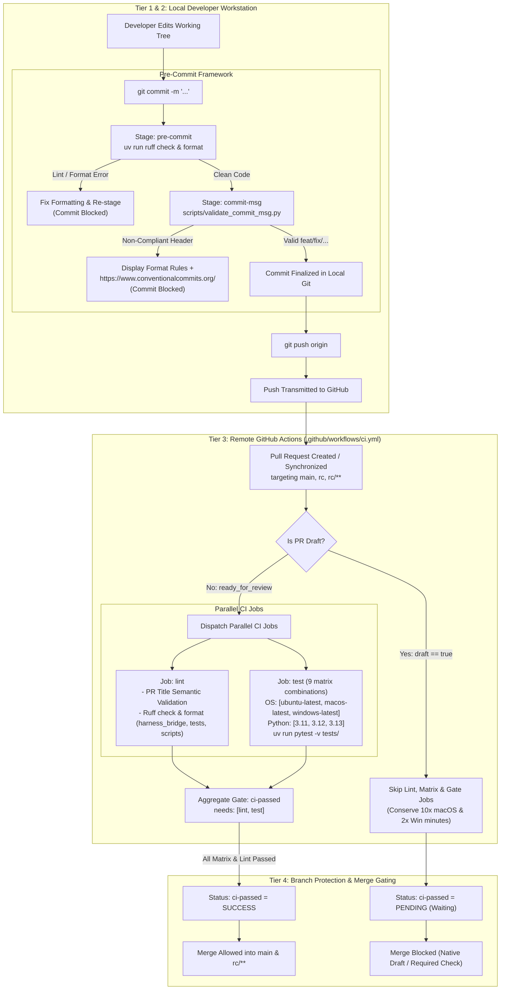

# Architecture Design Document: Developer Workflow, Local Git Hooks & CI Gating Pipeline

* **Target Milestone:** `v0.1.0 - Lifecycle Management & Configuration Sharing` (Developer Ergonomics & Quality Infrastructure)
* **Status:** Final / Approved
* **Authors:** Sukumar Rastogi (`sukumar1210`)
* **Date:** 2026-11-13
* **Component Tags:** `ci`, `git-hooks`, `pre-commit`, `github-actions`, `testing`, `branch-protection`, `contributor-experience`

---

## Context & Motivation

Harness Bridge serves as a multi-agent coordination proxy and Model Context Protocol ([MCP](https://modelcontextprotocol.io/)) server. Because it orchestrates cross-process execution and inter-harness communication across Linux, macOS, and Windows environments, code quality and test reliability are paramount.

Currently, several developer friction points and quality risks exist:
1. **Late Failure Feedback**: Linting, formatting, and test regressions are caught only after a contributor commits, pushes to GitHub, and waits several minutes for remote GitHub Actions dispatch.
2. **Unconstrained Commit Messages & PR Titles**: Commit message formatting is not validated locally, and PR titles are not validated in CI, leading to inconsistent git history and malformatted squash-merge headers on `main` that hamper automated changelog generation.
3. **CI Runner Resource Inefficiencies**: The current GitHub Actions workflow executes the complete 9-permutation matrix (3 OSes × 3 Python versions) on every push to every PR—including early Draft PRs. Because GitHub Actions bills macOS runners at 10x and Windows at 2x the Linux rate, running matrix builds on WIP commits burns shared open-source runner allowances rapidly.
4. **Fragile Branch Protection Configuration**: GitHub branch protection rules that target individual matrix job permutation names (such as `test (ubuntu-latest, 3.12)`) break whenever supported Python versions are updated or removed.
5. **Lack of Release Candidate Gating**: Target branches for release stabilization (`rc`, `rc/**`) do not have formalized merge gating enforced alongside `main`.

This document specifies the technical design for a four-tier quality gating and CI/CD workflow: local pre-commit checks, opt-in pre-push regression gating, draft-optimized remote CI matrix testing, and aggregate branch protection enforcement.

---

## User Stories & Concrete CUJs

### CUJ 1: Early Local Hygiene with Instant Conventional Commits Guidance
* **Given**: A contributor writing a new driver feature who attempts to commit with a generic message `git commit -m "added driver changes"`.
* **When**: The local Git hook executes at the `commit-msg` stage.
* **Then**:
  1. The hook intercepts the non-compliant commit message before Git finalizes the commit.
  2. The terminal displays clear diagnostic output highlighting allowed types (`feat`, `fix`, `docs`, etc.), format templates, and the explicit specification URL: `https://www.conventionalcommits.org/`.
  3. The commit is rejected without modifying local working tree state, allowing the developer to immediately correct their commit message.
  4. Standard Git pull operations (such as `Merge remote-tracking branch 'origin/main'`) and reverts are automatically recognized and permitted.

### CUJ 2: Preventing Untested Commits from Reaching Remotes (Opt-In Local / Mandatory Remote)
* **Given**: A developer who edits code in `harness_bridge/session/` and pushes changes via `git push origin feat/hop-limit`.
* **When**: The push is transmitted to GitHub.
* **Then**:
  1. If the developer enabled the optional `pre-push` hook, `uv run pytest -v tests/` verifies unit tests locally in ~0.5 seconds prior to push.
  2. In all cases, remote GitHub Actions CI executes the authoritative test matrix across Linux, macOS, and Windows before any merge can proceed.

### CUJ 3: Resource-Conscious Draft PR Iteration
* **Given**: A contributor who opens a Draft Pull Request targeting `main` to share an in-progress architectural spike with peers.
* **When**: The author pushes successive commits to the Draft PR branch.
* **Then**:
  1. GitHub Actions detects `draft == true` and skips the 9-job test matrix and `ci-passed` gate job, conserving macOS and Windows runner minutes.
  2. GitHub displays `ci-passed` as `"Expected — Waiting for status to be reported"`, natively blocking merge without failing the workflow run or emitting spurious failure notifications.

### CUJ 4: Zero-Friction Transition to Review and Protected Merge
* **Given**: A contributor who has completed implementation, verified local tests, and clicks "Ready for review" on GitHub.
* **When**: The `ready_for_review` event is emitted.
* **Then**:
  1. GitHub Actions automatically spins up the complete matrix (Linux, macOS, Windows across Python 3.11, 3.12, and 3.13) along with Ruff linting across `harness_bridge`, `tests`, and `scripts`.
  2. A dedicated CI step validates that the PR Title strictly follows Conventional Commits.
  3. Upon successful completion of all matrix permutations, the aggregate job `ci-passed` evaluates to `success`.
  4. GitHub Branch Protection acknowledges `ci-passed` and enables the green merge button.

---

## Goals & Non-Goals

### In-Scope Goals
* **Native Python Pre-Commit Integration**: Manage local hooks cleanly using the standard Python `pre-commit` framework declared in `pyproject.toml` dev dependencies, executing local binaries via `uv run` with zero external cloning.
* **Educational Commit Message Enforcement**: Enforce Conventional Commits locally at `commit-msg` stage via `scripts/validate_commit_msg.py`, displaying actionable guidance and `https://www.conventionalcommits.org/` on violation, while allowing standard `git pull` merge commits.
* **Server-Side PR Title Validation**: Validate PR titles against Conventional Commits in GitHub Actions CI to guarantee clean history upon squash-merging.
* **Draft PR Resource Optimization**: Dynamically skip matrix executions while pull requests remain in Draft status, waking runners only when marked "Ready for review" or on subsequent non-draft pushes.
* **Resilient Aggregate Branch Protection (`ci-passed`)**: Provide a single, immutable status check name (`ci-passed`) that aggregates all lint and test matrix outcomes for branch protection rules on `main` and `'rc/**'`.
* **Clear Contributor Documentation**: Fully document hook installation commands (`uv run pre-commit install`) and the Draft PR workflow in `CONTRIBUTING.md`.

### Out-of-Scope Non-Goals
* **No Node.js / Husky Runtime**: Do not introduce `package.json`, Node.js, or npm dependencies into the pure Python repository.
* **No Mandatory Heavy Push Blocking**: Do not mandate slow or disruptive integration checks on standard git pushes; mandatory local hooks are restricted to sub-second syntactic hygiene (`pre-commit`, `commit-msg`).
* **No Automated GitHub REST API Configuration**: Configuring GitHub branch protection settings remains a standard repository administrator task in GitHub's web interface rather than requiring automated personal access tokens or programmatic API scripts.

---

## Technical Plan & Architecture

The architecture implements a **four-tiered defense-in-depth verification pipeline** that balances developer velocity with absolute repository integrity:



---

### Component 1: Local Pre-Commit Infrastructure (`.pre-commit-config.yaml`)

#### Hook Configuration Design
To eliminate dependency drift and avoid external cloning into `~/.cache/pre-commit/`, the `.pre-commit-config.yaml` file configures Ruff and in-repo scripts as local system hooks executed via `uv run`, using `pyproject.toml` as the single source of truth:

```yaml
default_install_hook_types: [pre-commit, commit-msg]
default_stages: [pre-commit]

repos:
  # Stage: pre-commit - Fast linting and format checking on staged changes
  - repo: local
    hooks:
      - id: ruff-lint
        name: ruff-lint
        entry: uv run ruff check --fix
        language: system
        types: [python]
        stages: [pre-commit]
      - id: ruff-format
        name: ruff-format
        entry: uv run ruff format
        language: system
        types: [python]
        stages: [pre-commit]

  # Stage: commit-msg - Conventional Commits enforcement with specification link
  - repo: local
    hooks:
      - id: conventional-commit-msg
        name: enforce-conventional-commits
        entry: uv run python scripts/validate_commit_msg.py
        language: system
        stages: [commit-msg]

  # Stage: pre-push (Optional) - Fast unit test regression gate
  - repo: local
    hooks:
      - id: pytest-pre-push
        name: pytest-unit-tests
        entry: uv run pytest -v tests/
        language: system
        pass_filenames: false
        stages: [pre-push]
```

#### Key Design Decisions for Pre-Commit
1. **Sub-Second Mandatory Hook Stages (`default_install_hook_types: [pre-commit, commit-msg]`)**: Mandatory hooks execute in under 100ms. Unit test execution via `pre-push` is preserved as an optional opt-in stage (`uv run pre-commit install --hook-type pre-push`) so WIP spikes and branch deletions are never blocked.
2. **Local System Execution via `uv run`**: Leverages the virtual environment managed by `uv sync`, eliminating external git repo cloning into `~/.cache/pre-commit/` and guaranteeing version parity with `pyproject.toml`.
3. **Emergency Operational Escape Hatch**: Developers can pass `--no-verify` (`git commit --no-verify`, `git push --no-verify`) during urgent hotfixes or intermediate syncing.

---

### Component 2: Commit Message Validator Script (`scripts/validate_commit_msg.py`)

To strictly fulfill the mandate that non-compliant commit messages must output the Conventional Commits specification link while supporting routine `git pull` operations, a dedicated, zero-dependency Python script resides at `scripts/validate_commit_msg.py`:

```python
#!/usr/bin/env python3
"""Conventional Commits commit-msg validation hook.

Validates that commit messages adhere to Conventional Commits v1.0.0.
On failure, prints actionable diagnostic output and the explicit specification URL:
https://www.conventionalcommits.org/
"""

from __future__ import annotations

import re
import sys
from pathlib import Path

# Pattern matching Conventional Commits: type(scope optional)[!]?: subject
CONVENTIONAL_PATTERN = re.compile(
    r"^(?P<type>feat|fix|docs|style|refactor|perf|test|build|ci|chore|revert)"
    r"(\((?P<scope>[a-zA-Z0-9_\-\./]+)\))?"
    r"(?P<breaking>!)?"
    r":\s+"
    r"(?P<subject>[^\n\r]+)"
)

# Automated tooling and merge commit bypass patterns
BYPASS_PATTERNS = [
    re.compile(r"^Merge (remote-tracking )?branch .*"),
    re.compile(r"^Merge branches? .*"),
    re.compile(r"^Merge pull request .*"),
    re.compile(r"^Merge tag .*"),
    re.compile(r"^Revert \".*\""),
]


def main() -> int:
    if len(sys.argv) < 2:
        sys.stderr.write("Error: commit message file path not provided.\n")
        return 1

    msg_file = Path(sys.argv[1])
    try:
        content = msg_file.read_text(encoding="utf-8").strip()
    except Exception as e:
        sys.stderr.write(f"Error reading commit message file: {e}\n")
        return 1

    # Extract first non-comment line
    lines = [line.strip() for line in content.splitlines() if not line.strip().startswith("#")]
    if not lines:
        sys.stderr.write("Error: Empty commit message.\n")
        return 1

    first_line = lines[0]

    # Allow merge and revert commits
    for bp in BYPASS_PATTERNS:
        if bp.match(first_line):
            return 0

    if not CONVENTIONAL_PATTERN.match(first_line):
        sys.stderr.write("\n" + "=" * 70 + "\n")
        sys.stderr.write("❌ [COMMIT REJECTED] Non-Compliant Commit Message Format\n")
        sys.stderr.write("=" * 70 + "\n\n")
        sys.stderr.write(f'Your commit message header was:\n  "{first_line}"\n\n')
        sys.stderr.write(
            "Harness Bridge strictly enforces the Conventional Commits specification.\n"
        )
        sys.stderr.write(
            "Allowed types: feat, fix, docs, style, refactor, perf, test, build, ci, chore, revert\n\n"
        )
        sys.stderr.write("Format:\n")
        sys.stderr.write("  <type>[optional scope][!]: <description>\n\n")
        sys.stderr.write("Examples:\n")
        sys.stderr.write("  feat(drivers): add Claude Code streaming protocol handler\n")
        sys.stderr.write("  fix(session): prevent pipe deadlock on large subprocess diffs\n")
        sys.stderr.write("  feat(server)!: breaking redesign of MCP registration endpoint\n")
        sys.stderr.write("  docs(contributing): document local git hooks and CI gating\n\n")
        sys.stderr.write("👉 For complete specification rules and guidelines, visit:\n")
        sys.stderr.write("   https://www.conventionalcommits.org/\n")
        sys.stderr.write("=" * 70 + "\n\n")
        return 1

    return 0


if __name__ == "__main__":
    sys.exit(main())
```

---

### Component 3: Draft-Optimized Remote CI Pipeline (`.github/workflows/ci.yml`)

#### Event Triggers & Branch Scoping
The workflow triggers on `main`, `rc`, and all release candidate sub-branches (`'rc/**'`):
* **Pull Request Activity Types**: `[opened, synchronize, reopened, ready_for_review]`.
* **Draft Bypass Logic**: `if: github.event_name != 'pull_request' || !github.event.pull_request.draft`. When a pull request is marked as a Draft, all jobs (including `ci-passed`) are skipped, preventing hundreds of wasted runner minutes during iterative spikes.
* **Server-Side PR Title Validation**: Validates `github.event.pull_request.title` during the `lint` job to ensure squash merges on `main` maintain Conventional Commits integrity.
* **Aggregate Gating (`ci-passed`)**: A dedicated job with `needs: [lint, test]` that runs only on non-draft PRs and pushes, reporting `success` when all upstream matrix checks pass.

```yaml
name: CI

on:
  push:
    branches:
      - main
      - rc
      - 'rc/**'
  pull_request:
    branches:
      - main
      - rc
      - 'rc/**'
    types:
      - opened
      - synchronize
      - reopened
      - ready_for_review

concurrency:
  group: ${{ github.workflow }}-${{ github.head_ref || github.ref }}
  cancel-in-progress: ${{ github.ref != 'refs/heads/main' && !startsWith(github.ref, 'refs/heads/rc') }}

jobs:
  lint:
    name: lint
    runs-on: ubuntu-latest
    if: github.event_name != 'pull_request' || !github.event.pull_request.draft
    steps:
      - uses: actions/checkout@v4

      - name: Install uv
        uses: astral-sh/setup-uv@v5
        with:
          enable-cache: true

      - name: Set up Python
        run: uv python install 3.13

      - name: Install dependencies
        run: uv sync

      - name: Validate PR Title (Conventional Commits)
        if: github.event_name == 'pull_request'
        run: |
          uv run python -c '
          import re, sys
          pattern = r"^(feat|fix|docs|style|refactor|perf|test|build|ci|chore|revert)(\([a-zA-Z0-9_\-\./]+\))?(!)?: .+"
          title = """${{ github.event.pull_request.title }}"""
          if not re.match(pattern, title):
              print(f"❌ PR Title \"{title}\" does not follow Conventional Commits: https://www.conventionalcommits.org/")
              sys.exit(1)
          '

      - name: Run Ruff Lint & Format Check
        run: |
          uv run ruff check harness_bridge tests scripts
          uv run ruff format --check harness_bridge tests scripts

  test:
    name: test (${{ matrix.os }}, py${{ matrix.python-version }})
    runs-on: ${{ matrix.os }}
    if: github.event_name != 'pull_request' || !github.event.pull_request.draft
    strategy:
      fail-fast: false
      matrix:
        os: [ubuntu-latest, macos-latest, windows-latest]
        python-version: ["3.11", "3.12", "3.13"]

    steps:
      - uses: actions/checkout@v4

      - name: Set up Python & uv
        uses: astral-sh/setup-uv@v5
        with:
          python-version: ${{ matrix.python-version }}
          enable-cache: true

      - name: Install dependencies
        run: uv sync

      - name: Run tests
        run: uv run pytest -v tests/

  ci-passed:
    name: ci-passed
    runs-on: ubuntu-latest
    needs: [lint, test]
    if: github.event_name != 'pull_request' || !github.event.pull_request.draft
    steps:
      - name: Confirm Aggregate CI Status
        shell: bash
        run: |
          echo "✅ All CI checks (Lint, PR Title, and Test Matrix across Linux, macOS, and Windows) completed successfully!"
          exit 0
```

---

### Component 4: Branch Protection Configuration & Merge Enforcement

#### Required Status Check Binding
In GitHub repository settings, branch protection rules for `main` and `'rc/**'` are configured with:
1. **Require status checks to pass before merging**: Enabled.
2. **Require branches to be up to date before merging**: Enabled (`strict: true`).
3. **Required Status Check**: Exactly `ci-passed`.

#### Operational Behavior Matrix

| Pull Request State | Upstream `lint` & `test` State | `ci-passed` Status | Branch Protection Result | Merge Outcome |
| :--- | :--- | :--- | :--- | :--- |
| **Draft PR** | `skipped` (due to `if: !draft`) | `skipped` (pending in GitHub) | Check Pending / Required | **Merge Blocked** |
| **Ready for Review (Passing)** | `success` across all 9 matrix jobs | `success` (exit 0) | Check Passed | **Merge Allowed** |
| **Ready for Review (Failing Test)** | `failure` (1 or more matrix jobs fail) | `skipped` (upstream failure) | Check Missing / Failed | **Merge Blocked** |
| **New Commit Pushed During Review** | Re-triggered via `synchronize` | Evaluated against latest commit | Up-to-date check required | **Safely Re-evaluated** |

---

### Component 5: Dependency Management & Documentation Updates

#### `pyproject.toml`
Add `pre-commit` to developer dependencies:
```toml
[dependency-groups]
dev = [
    "pytest>=8.0.0",
    "pytest-asyncio>=0.23.0",
    "ruff>=0.8.0",
    "pre-commit>=4.0.0",
]
```

#### `CONTRIBUTING.md`
Add explicit developer tooling and draft PR lifecycle instructions:
1. Canonical one-line hook setup: `uv run pre-commit install` (arms `pre-commit` and `commit-msg`).
2. Optional pre-push hook: `uv run pre-commit install --hook-type pre-push` for developers wanting local push gating.
3. Explaining Conventional Commits (`type(scope): message`) with reference to `https://www.conventionalcommits.org/`.
4. Outlining the Draft PR lifecycle: open PRs as Draft during WIP to save runner minutes, and click "Ready for review" to invoke the full multi-OS matrix.

---

## Alternatives Considered

During design exploration and multi-lens architectural review, five key alternatives were evaluated:

### 1. Husky (`.husky/` + Node.js / npm)
* **Mechanism**: Use the Node.js Husky package and commitlint (`@commitlint/cli`, `@commitlint/config-conventional`) via `package.json`.
* **Trade-offs**: Familiar to full-stack and TypeScript developers; widely used in web projects.
* **Failure Modes**: Introduces a foreign runtime (Node.js and npm/pnpm) into a pure Python repository. Python contributors without Node.js installed would face broken setup scripts or failed commits.
* **Decision**: *Rejected by author*. Harness Bridge remains a pure Python repository powered by `uv`. Python's native `pre-commit` framework integrates natively with `pyproject.toml` dev dependencies and virtual environments.

### 2. Triggering PR Workflows on `review_requested`
* **Mechanism**: Configure GitHub Actions to trigger exclusively when reviewers are added (`on.pull_request.types: [review_requested]`).
* **Trade-offs**: Conserves CI minutes by avoiding running tests until a maintainer is tagged.
* **Failure Modes**: 
  1. Does not trigger if a PR is marked ready for review without assigning specific individuals.
  2. If a contributor pushes additional fix commits while a review is underway, `review_requested` does not re-fire, leaving new commits untested and branch protection checks out-of-date.
* **Decision**: *Rejected by author*. The native GitHub Draft PR lifecycle (`ready_for_review` combined with `[opened, synchronize, reopened]` and `if: !github.event.pull_request.draft`) provides superior ergonomics. Draft PRs burn zero runner minutes, while ready PRs test every commit revision automatically.

### 3. Hardcoding Individual Matrix Permutations in Branch Protection Rules
* **Mechanism**: In GitHub branch protection settings, require every individual matrix job name (e.g., `test (ubuntu-latest, 3.11)`, `test (ubuntu-latest, 3.12)`, `test (macos-latest, 3.13)`, etc.).
* **Trade-offs**: Direct inspection of every individual OS/Python combination in GitHub's native rule UI.
* **Failure Modes**: Tight coupling between repository administration and workflow YAML syntax. Whenever a Python version is added (e.g., 3.14) or an OS runner label changes, branch protection rules break or block all PR merges until an administrator manually updates repository settings.
* **Decision**: *Rejected by author*. Adopted the **Aggregate Proxy Gate pattern (`ci-passed`)**. GitHub branch protection binds exclusively to `ci-passed`. The internal matrix permutations can evolve freely in `.github/workflows/ci.yml` without administrative intervention.

### 4. Third-Party Pre-Commit Hook Repositories for Commit Messages
* **Mechanism**: Reference an external hook repository such as `compilerla/conventional-pre-commit` in `.pre-commit-config.yaml`.
* **Trade-offs**: Offloads regex maintenance to an external community repository.
* **Failure Modes**: External hooks clone separate Git repositories and create isolated virtual environments on every developer machine, introducing network latency and third-party supply-chain risks. Crucially, existing third-party hooks do not print the mandatory Conventional Commits specification link (`https://www.conventionalcommits.org/`) upon rejection.
* **Decision**: *Rejected by author*. Implemented an in-repo, zero-dependency Python script at `scripts/validate_commit_msg.py`. It runs instantly via `uv run`, guarantees exact adherence to error messaging specifications, and eliminates external dependencies.

### 5. Native Git Hooks via `core.hooksPath = .githooks`
* **Mechanism**: Commit shell scripts inside a `.githooks/` directory and instruct contributors to configure `git config core.hooksPath .githooks`.
* **Trade-offs**: Zero additional Python packages required.
* **Failure Modes**: Windows contributors running cmd or PowerShell without bash encounter shell execution errors; lacks built-in caching and hook version management for tools like Ruff.
* **Decision**: *Rejected by author*. Python `pre-commit` provides cross-platform execution, automated hook lifecycle management, and seamless virtual environment isolation.

---

## Detailed Implementation Plan

This section provides an actionable, sequenced execution roadmap. Every impacted file is enumerated with its repository-relative path, followed by a concrete rationale and technical description.

### 1. Touched Files Inventory

| File Path | Operation | Component | Rationale |
| :--- | :--- | :--- | :--- |
| `pyproject.toml` | **Modify** | Dependency Management | Add `pre-commit>=4.0.0` to `[dependency-groups.dev]` so the framework installs during `uv sync`. |
| `uv.lock` | **Modify** | Dependency Lockfile | Updated automatically by `uv sync` when adding `pre-commit`; must be committed to maintain deterministic environment state. |
| `.pre-commit-config.yaml` | **Create** | Local Git Hooks | Authoritative hook definition declaring `pre-commit` (local system Ruff lint/format), `commit-msg` (validator script), and optional `pre-push` (`pytest`) stages. |
| `scripts/validate_commit_msg.py` | **Create** | Hook Script | Zero-dependency Python CLI script that parses commit messages, validates against Conventional Commits regex, and prints `https://www.conventionalcommits.org/` on error, with merge/revert bypasses. |
| `tests/test_validate_commit_msg.py` | **Create** | Unit Test Suite | Comprehensive pytest suite verifying that valid commit types pass, invalid types fail with exit code 1, merge/revert headers pass, and error output contains the specification URL. |
| `.github/workflows/ci.yml` | **Modify** | Remote CI Pipeline | Expand branch triggers to `main`, `rc`, `'rc/**'`; add PR activity types (`opened`, `synchronize`, `reopened`, `ready_for_review`); add PR title check; expand Ruff to `scripts`; add draft skip; add `ci-passed` gate job. |
| `CONTRIBUTING.md` | **Modify** | Documentation | Update `Getting Started` with the canonical hook installation command (`uv run pre-commit install`), explain the Draft PR lifecycle, and link to Conventional Commits. |
| `scripts/README.md` | **Modify** | Documentation | Update title to Platform Scripts and register `scripts/validate_commit_msg.py` in the scripts subtree contract, detailing its CLI arguments, exit codes, and operational behavior. |

---

### 2. Sequential Execution Roadmap

#### Phase 1: Local Hook Infrastructure & Dependencies
1. **Update `pyproject.toml` & `uv.lock`**:
   - Append `"pre-commit>=4.0.0"` to the existing `dev` dependency array in `[dependency-groups]`.
   - Run `uv sync` to lock dependencies and provision the `pre-commit` binary within `.venv/bin/`.
   - Verify `uv.lock` is updated and staged for commit.
2. **Implement Commit Message Validator (`scripts/validate_commit_msg.py`)**:
   - Create an executable Python script accepting a single argument: path to the commit message file (`.git/COMMIT_EDITMSG`).
   - Define a regular expression matching `<type>(<optional-scope>)[!]?: <subject>` where `<type>` is constrained to: `feat`, `fix`, `docs`, `style`, `refactor`, `perf`, `test`, `build`, `ci`, `chore`, `revert`.
   - Strip comment lines starting with `#` and ignore empty leading/trailing whitespace.
   - Include bypass patterns for merge commits (`^Merge (remote-tracking )?branch .*`, `^Merge branches? .*`, `^Merge pull request .*`, `^Merge tag .*`) and revert commits (`^Revert ".*"`).
   - On non-compliance, format terminal diagnostics to `sys.stderr` printing:
     - The rejected header line.
     - Allowed types and formatting schema.
     - Concrete examples of valid commits.
     - The exact specification URL: `https://www.conventionalcommits.org/`.
   - Return exit code `0` on success and `1` on failure.
3. **Author Automated Tests (`tests/test_validate_commit_msg.py`)**:
   - Verify script execution using `subprocess.run` across synthetic commit message temporary files using `sys.executable`:
     - Valid commits: `feat: add driver`, `fix(session): resolve pipe deadlock`, `docs(contributing): update guide`, `feat(drivers)!: breaking api change`.
     - Invalid commits: `added driver`, `FEAT: uppercase`, `fix:`, `wip`, `refactor(): empty scope`.
     - Revert and merge bypasses: `Merge remote-tracking branch 'origin/main' into feature`, `Merge branch 'main' of ...`.
     - Edge cases: comment-only files, empty files, missing CLI argument.
     - Assertion on error message: Verify string `https://www.conventionalcommits.org/` is present in stderr.
4. **Create Pre-Commit Configuration (`.pre-commit-config.yaml`)**:
   - Set `default_install_hook_types: [pre-commit, commit-msg]`.
   - Hook 1: Local system hook `ruff-lint` executing `uv run ruff check --fix` at stage `[pre-commit]`.
   - Hook 2: Local system hook `ruff-format` executing `uv run ruff format` at stage `[pre-commit]`.
   - Hook 3: Local system hook `conventional-commit-msg` invoking `uv run python scripts/validate_commit_msg.py` at stage `[commit-msg]`.
   - Hook 4: Optional local hook `pytest-pre-push` invoking `uv run pytest -v tests/` at stage `[pre-push]` with `pass_filenames: false`.
5. **Local Hook Verification**:
   - Install hooks via `uv run pre-commit install`.
   - Verify pre-commit stage: `uv run pre-commit run --all-files`.
   - Verify commit-msg stage: `uv run pre-commit run conventional-commit-msg --hook-stage commit-msg --commit-msg-filename <(echo "feat: test message")`.

---

#### Phase 2: Remote CI Workflow Modernization
1. **Update `.github/workflows/ci.yml` Triggers, Concurrency & Caching**:
   - Update `on.push.branches` to include `main`, `rc`, and `'rc/**'`.
   - Update `on.pull_request.branches` to include `main`, `rc`, and `'rc/**'`.
   - Set `on.pull_request.types` explicitly to `[opened, synchronize, reopened, ready_for_review]`.
   - Set concurrency with non-release cancellation:
     `cancel-in-progress: ${{ github.ref != 'refs/heads/main' && !startsWith(github.ref, 'refs/heads/rc') }}`.
2. **Implement PR Title Validation & Expanded Linting in `lint` Job**:
   - Add PR title validation step verifying Conventional Commits on pull request events.
   - Expand Ruff commands to include `scripts`: `uv run ruff check harness_bridge tests scripts` and `uv run ruff format --check harness_bridge tests scripts`.
   - Add job conditional: `if: github.event_name != 'pull_request' || !github.event.pull_request.draft`.
3. **Streamline `test` Matrix Job**:
   - Add job conditional: `if: github.event_name != 'pull_request' || !github.event.pull_request.draft`.
   - Configure `astral-sh/setup-uv@v5` with `python-version: ${{ matrix.python-version }}` and `enable-cache: true`.
4. **Implement Aggregate Gatekeeper (`ci-passed`)**:
   - Define job `ci-passed` with `needs: [lint, test]`, `runs-on: ubuntu-latest`, and `if: github.event_name != 'pull_request' || !github.event.pull_request.draft`.
   - Step outputs confirmation message and exits 0.

---

#### Phase 3: Documentation & Blueprint Synchronization
1. **Update `CONTRIBUTING.md`**:
   - Add a dedicated subsection under `Getting Started` entitled `Local Git Hooks (pre-commit)`.
   - Provide the canonical installation command: `uv run pre-commit install`.
   - Document optional pre-push testing: `uv run pre-commit install --hook-type pre-push`.
   - Document `--no-verify` escape hatch for emergency workflows.
   - Outline the Draft PR workflow: open PRs as Draft while iterating, and click "Ready for review" to trigger the multi-OS test matrix.
   - Explain Conventional Commits formatting rules and provide the link to `https://www.conventionalcommits.org/`.
2. **Update `scripts/README.md`**:
   - Retitle header to `# Platform Scripts (scripts)` to encompass both installation and developer tooling.
   - Document `scripts/validate_commit_msg.py` as an architectural contract of the repository tooling, detailing its CLI arguments, exit codes, and regex matching rules.

---

#### Phase 4: GitHub Repository Branch Protection Configuration
1. **Navigate to GitHub Repository Settings**:
   - Go to `Settings -> Branches -> Branch protection rules` (or `Rulesets`).
2. **Apply Protection to Target Branches**:
   - Rule 1 branch pattern: `main`.
   - Rule 2 branch pattern: `'rc/**'`.
   *(Alternatively, create a single GitHub Ruleset targeting both `refs/heads/main` and `refs/heads/rc/**`).*
3. **Configure Required Checks**:
   - Enable "Require status checks to pass before merging".
   - Enable "Require branches to be up to date before merging".
   - Search for and select strictly: **`ci-passed`**.
   *(Note: Merge or push the workflow PR first so that GitHub Actions emits `ci-passed` at least once, allowing it to be discovered in the search box).*
4. **Enforce Linear History (Recommended)**:
   - Require linear commit history to ensure all commits on `main` adhere to Conventional Commits.
