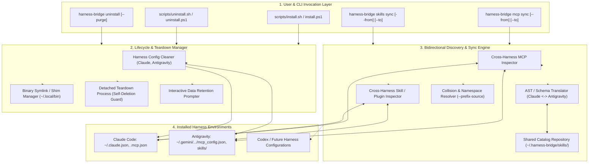

# Architecture Design Document: Lifecycle Management, Clean Uninstallation & Bidirectional Configuration Sharing

* **Target Milestone:** `v0.1.0 - Lifecycle Management & Configuration Sharing`
* **Status:** Draft / Under Multi-Lens Review
* **Authors:** Sukumar Rastogi (`sukumar1210`)
* **Date:** 2026-11-12
* **Component Tags:** `lifecycle`, `mcp`, `cli`, `security`, `platform:linux`, `platform:windows`, `platform:macos`

---

## Context & Motivation

As Harness Bridge expands to unify disparate AI coding agent harnesses (Claude Code, Antigravity, Codex) across multi-turn swarms and remote gateways, two operational bottlenecks emerge in developer ergonomics:

1. **Incomplete Lifecycle Teardown & Lingering State**:
   * Harness Bridge registers itself as an active Model Context Protocol (MCP) server in user configuration files (`~/.claude.json`, `.mcp.json`, `~/.gemini/antigravity-cli/mcp_config.json`) and installs binaries to `~/.local/bin` and `~/.harness-bridge/venv`.
   * Without a dedicated uninstaller, removing the tool leaves orphan MCP configuration blocks in Claude Code and Antigravity, causing noisy broken-pipe errors (`spawn harness-bridge ENOENT`) on every subsequent agent session.
   * Furthermore, developer state—such as SQLite runs databases (`~/.harness-bridge/runs.db`), token analytics, custom team presets, and cached telemetry—requires transparent retention policies with clear user prompts rather than silent permanent deletion or lingering unmanaged bloat.

2. **Isolated MCP & Skill Configuration Silos**:
   * Developers configure rich sets of MCP servers (database clients, GitHub tools, Kubernetes connectors, web fetchers) and agent skills (`SKILL.md` workflows, custom prompts) within specific harness environments.
   * Currently, these configurations are siloed: an MCP server or skill configured in Antigravity is invisible to Claude Code, and vice versa. Developers are forced to manually copy, reformat, and maintain duplicate JSON and Markdown configurations across multiple directories.
   * Harness Bridge requires a bidirectional discovery, translation, and sharing layer capable of discovering MCP servers, plugins, and skills from each installed harness, presenting unified inventories, and synchronizing them across environments with collision safety.

This document specifies the technical design for **Comprehensive Lifecycle & Uninstaller Management** and **Bidirectional MCP & Skill Configuration Sharing**.

---

## User Stories & Concrete CUJs

### CUJ 1: Clean Platform Teardown with Preserved Historical State
* **Given**: A developer who has used Harness Bridge with Claude Code and Antigravity over several projects and wants to uninstall the runtime.
* **When**: The user runs `harness-bridge uninstall` (or downloads and executes `curl -sSL https://raw.githubusercontent.com/sukumar1210/harness-bridge/main/scripts/uninstall.sh | bash`).
* **Then**:
  1. The uninstaller unregisters the `harness-bridge` entry from Claude Code (`~/.claude.json`, `.mcp.json`) and Antigravity (`mcp_config.json`).
  2. The uninstaller unlinks the binary shim at `~/.local/bin/harness-bridge`.
  3. An interactive prompt asks: *"Preserve historical database (~/.harness-bridge/runs.db) and custom presets? [Y/n]"*.
  4. The user accepts, keeping their telemetry database intact while deleting the virtual environment (`~/.harness-bridge/venv`), exiting cleanly with zero broken MCP hooks remaining in their harnesses.

### CUJ 2: Automated CI/Purge Teardown
* **Given**: An ephemeral CI runner or clean VM testing Harness Bridge.
* **When**: The teardown script executes `harness-bridge uninstall --purge --yes`.
* **Then**: The runtime non-interactively wipes the virtual environment, all configuration files, all symlinks, and completely purges `~/.harness-bridge/`, leaving zero filesystem artifacts.

### CUJ 3: Cross-Harness MCP Server Discovery & Sync
* **Given**: A developer with Antigravity configured with SQLite and Docker MCP servers in `~/.gemini/antigravity-cli/mcp_config.json`, and Claude Code installed without those servers.
* **When**: The developer runs `harness-bridge mcp sync --from agy --to claude`.
* **Then**:
  1. Harness Bridge inspects Antigravity's MCP configuration, extracting server definitions, executable commands, arguments, and environment variables.
  2. It validates compatibility against Claude Code's `.mcp.json` / `~/.claude.json` format.
  3. It detects existing entries, preserves existing servers, and merges the new entries cleanly.
  4. Both Antigravity and Claude Code can now access the same SQLite and Docker MCP tools.

### CUJ 4: Agent Skill Discovery & Unified Sharing
* **Given**: An engineer authoring a project audit skill in Antigravity (`.gemini/skills/audit-codebase/SKILL.md`).
* **When**: The engineer runs `harness-bridge skills sync --from agy --to shared` (or calls MCP tool `bridge_list_discovered_skills`).
* **Then**:
  1. Harness Bridge parses the frontmatter and markdown body of all skills.
  2. It exports them into a standardized shared catalog (`~/.harness-bridge/skills/`) and translates them into Claude Code compatible prompt templates or slash commands.
  3. Calling sessions in either harness can inspect available capabilities across the entire local machine.

---

## Goals & Non-Goals

### Goals
* **Deterministic & Complete Lifecycle Teardown**: Provide dedicated uninstallation tools (`harness-bridge uninstall`, `scripts/uninstall.sh`, `scripts/uninstall.ps1`) that safely remove virtual environments, binary shims, and temporary files across Linux, macOS, and Windows.
* **Orphan MCP Cleanup**: Cleanly unregister `harness-bridge` entries from all detected harness configurations (Claude Code `~/.claude.json`, `.mcp.json` and Antigravity `mcp_config.json`), preventing broken-pipe errors on subsequent agent launches.
* **Transparent Data Retention**: Guarantee developer state (`~/.harness-bridge/runs.db`, custom presets, token telemetry, logs) is preserved by default with clear interactive prompts, requiring explicit `--purge` for complete wiping.
* **Bidirectional MCP Server Synchronization**: Enable discovering and bidirectionally synchronizing third-party MCP server JSON definitions between Claude Code and Antigravity with collision detection and namespacing (`--prefix-source`).
* **Cross-Harness Skill Catalog**: Discover and catalog `SKILL.md` workflows across Antigravity and Claude Code environments, providing a centralized shared catalog (`~/.harness-bridge/skills/`) and MCP inspection tools.

### Non-Goals
* **Uninstalling Third-Party Harnesses**: Harness Bridge manages only its own binaries, virtual environments, and configuration entries; it does not uninstall or modify third-party agent harnesses (Claude Code, Antigravity) themselves.
* **Virtual In-Memory MCP Proxying**: Harness Bridge does not dynamically multiplex or runtime-proxy all third-party MCP tool calls in memory; static configuration synchronization provides reliable, direct tool execution within native harness processes.
* **Automated Natural Language Reconciliation**: Harness Bridge does not attempt automated semantic merging or resolution of conflicting instructions inside different prompt markdown bodies.

---

## Technical Plan (Architecture)

### 1. System Architecture Overview



---

### 2. Comprehensive Lifecycle & Uninstallation Architecture

#### 1. Data Retention Policy & TTY Prompting
The uninstaller guarantees transparent user consent before altering persistent developer records:
* **Default Policy (Preserve with Prompt)**:
  * In interactive TTY mode: Prompts user:
    ```text
    Harness Bridge Uninstaller
    ────────────────────────────────────────────────────────────
    [✓] Unregistered MCP hooks from Claude Code and Antigravity
    [✓] Removed executable shim at ~/.local/bin/harness-bridge
    [✓] Removed virtual environment at ~/.harness-bridge/venv

    Historical data detected:
      - State database (~/.harness-bridge/runs.db)
      - Custom presets (~/.harness-bridge/teams/)
      - Telemetry and logs

    Preserve historical database (~/.harness-bridge/runs.db) and custom presets? [Y/n]: 
    ```
  * In non-interactive mode (e.g. CI scripts, pipes): Defaults to **preserving** user data unless `--purge` is explicitly supplied.
* **Flags**:
  * `--purge`: Unconditionally wipes all data, presets, databases, and the parent `~/.harness-bridge` directory.
  * `--keep-data`: Unconditionally preserves user data, bypassing interactive prompts and only removing binaries and virtualenvs.
  * `--skip-mcp-cleanup`: Leaves external harness MCP configuration files (`~/.claude.json`, `mcp_config.json`) untouched.
  * `--yes` / `-y`: Assumes "yes" to confirmations (paired with `--purge` for automated teardown).
  * **Flag Conflict Validation**: Passing both `--purge` and `--keep-data` concurrently is rejected as an invalid mutually exclusive argument combination with exit code 2.

#### 2. Cross-Harness MCP Un-registration
Before removing binaries, the uninstaller invokes `cleanup_all_harnesses()`:
1. **Claude Code**:
   * Reads `~/.claude.json` and project-local `.mcp.json`.
   * Removes the `"harness-bridge"` key from `"mcpServers"`.
   * If `claude` CLI is available, also executes `claude mcp remove harness-bridge` to handle any harness-managed registrations.
2. **Antigravity**:
   * **Exhaustive Path Scrubbing**: Unlike sync operations (which adhere to single-target write precedence), `cleanup_all_harnesses()` iterates through **all** existing Antigravity configuration files returned by `get_agy_mcp_config_paths()`:
     1. `~/.gemini/antigravity-cli/mcp_config.json` (primary CLI configuration)
     2. `~/.gemini/config/mcp_config.json`
     3. `~/.gemini/antigravity/mcp_config.json`
   * Parses JSON, deletes the `"harness-bridge"` entry under `"mcpServers"` from every existing configuration file, and writes back with standard indentation. This guarantees no orphan registrations remain in secondary or legacy paths.
   * If `agy` CLI is available on system PATH, also executes `agy mcp remove harness-bridge` to ensure full removal parity with Claude Code.

#### 3. Two-Phase Detached Teardown (CLI Self-Deletion Protection)
When `harness-bridge uninstall` is executed, the running process is Python executing from `~/.harness-bridge/venv/bin/python`. On Windows, attempting to delete the running executable or directory triggers `WinError 32: The process cannot access the file because it is being used by another process`. On Linux/macOS, deleting open binaries or racing with interpreter exit can leave lingering directories.
* **Mechanism**:
  1. **Phase 1 (In-Process)**:
     * The Python CLI unregisters MCP configurations from all harnesses.
     * The CLI removes symlinks in `~/.local/bin/harness-bridge`.
     * If `--purge` is selected, user databases (`runs.db`), logs, and presets are deleted in-process.
  2. **Phase 2 (Detached Background Teardown with Parent PID Polling & Literal Path Interpolation)**:
     * To prevent race conditions, unbound shell variable errors (`rm -rf /venv`), and Windows file-locking deadlocks, the CLI does not rely on arbitrary sleep intervals or un-exported environment variables. Instead, it captures its own parent PID (`os.getpid()`), sets the working directory (`cwd`) outside `$INSTALL_DIR` (to `Path.home()`), and spawns a fully detached background supervisor process (`start_new_session=True` on Unix, `creationflags=subprocess.DETACHED_PROCESS | subprocess.CREATE_NEW_PROCESS_GROUP` on Windows) before immediately exiting with code 0:
       * **Linux / macOS**:
         ```bash
         (count=0; while kill -0 <PARENT_PID> 2>/dev/null && [ $count -lt 300 ]; do sleep 0.05; count=$((count+1)); done && rm -rf "<INSTALL_DIR>/venv" $( [ "<PURGE>" = "1" ] && echo "<INSTALL_DIR>" )) >/dev/null 2>&1 &
         ```
       * **Windows (Direct powershell.exe Invocation)**:
         ```powershell
         powershell.exe -NoProfile -ExecutionPolicy Bypass -Command "Wait-Process -Id <PARENT_PID> -Timeout 15 -ErrorAction SilentlyContinue; Remove-Item -Recurse -Force '<INSTALL_DIR>\venv' -ErrorAction SilentlyContinue; if ('<PURGE>' -eq '1') { Remove-Item -Recurse -Force '<INSTALL_DIR>' -ErrorAction SilentlyContinue }"
         ```
         *(Note: `<INSTALL_DIR>` and `<PURGE>` are interpolated as literal string constants by Python when building the argument string, avoiding unbound shell variable errors and ensuring direct binary invocation without cmdlet wrappers).*

#### 4. Standalone Shell Scripts Parity & TTY Prompting
* `scripts/uninstall.sh` (Linux/macOS) and `scripts/uninstall.ps1` (Windows) operate standalone, supporting execution via `curl -sSL .../uninstall.sh | bash` without requiring Python to remain installed.
* **Stdin Starvation Guard (`/dev/tty`)**:
  * In piped execution (`curl | bash`), standard input (`stdin`) is bound to the closed pipe stream rather than the user's terminal keyboard.
  * `scripts/uninstall.sh` detects this condition:
    ```bash
    if [ -t 0 ]; then
        read -r -p "Preserve historical database (~/.harness-bridge/runs.db) and custom presets? [Y/n]: " response
    elif [ -r /dev/tty ]; then
        read -r -p "Preserve historical database (~/.harness-bridge/runs.db) and custom presets? [Y/n]: " response </dev/tty
    else
        # Headless CI fallback: non-interactive safe default
        response="Y"
    fi
    ```
* **Standalone MCP Cleanup Execution Ladder**:
  To clean nested JSON configurations (`~/.claude.json`, `mcp_config.json`) safely without depending on a pre-existing host Python runtime or corrupting files with fragile regex:
  1. **Virtual Environment Python**: If `${VENV_DIR}/bin/python` exists, the script invokes `"${VENV_DIR}/bin/python" -m harness_bridge.core.lifecycle --cleanup-mcp-only` prior to venv deletion.
  2. **Harness CLI Invocations**: If harness CLIs are detected on PATH, executes `claude mcp remove harness-bridge` and `agy mcp remove harness-bridge`.
  3. **System Python / jq Fallback**: If system `python3` or `jq` is present, executes a safe JSON removal snippet removing `"harness-bridge"` from `"mcpServers"`.
  4. **Terminal Warning Guard**: If neither Python, jq, nor harness CLIs are available, the script emits a clear terminal warning instructing the user to manually verify their configuration files, refusing to attempt destructive regex/sed editing.
* Accepts identical flags: `--purge`, `--keep-data`, `--skip-mcp-cleanup`, `--yes`, `--install-dir <path>`, `--bin-dir <path>`.

---

### 3. Installer Enhancements (`install.sh` & `install.ps1`)

To provide feature parity with the uninstaller and support enterprise/CI deployments:
* **Default Behavior & Path Independence**:
  * `install.sh` and `install.ps1` now automatically execute `harness-bridge setup` at completion by default.
  * To guarantee setup succeeds even on first-time installations where `${BIN_DIR}` has not yet been exported into the active shell `$PATH`, the script executes setup directly via the virtual environment binary and passes the target executable path explicitly:
    ```bash
    "${VENV_DIR}/bin/harness-bridge" setup --executable "${BIN_DIR}/harness-bridge"
    ```
* **New Flags**:
  * `--no-mcp-setup`: Installs the package and binary shim, but skips automatic execution of `harness-bridge setup` (preserving previous manual behavior for minimal environments).
  * `--install-dir <path>`: Overrides installation directory (default: `~/.harness-bridge`).
  * `--bin-dir <path>`: Overrides binary symlink directory (default: `~/.local/bin` on Unix, `%USERPROFILE%\.local\bin` or Scripts on Windows).
  * `--yes` / `-y`: Non-interactive mode, suppresses interactive confirmation prompts.
  * `--version <ver>`: Installs a specific tagged release instead of latest.

---

### 4. Bidirectional MCP Server Discovery, Translation & Synchronization

#### 1. Cross-Harness Configuration Schemas
Different harnesses store MCP server configurations in slightly different schema dialects:
* **Claude Code Format** (`~/.claude.json`, `.mcp.json`):
  ```json
  {
    "mcpServers": {
      "sqlite": {
        "command": "uvx",
        "args": ["mcp-server-sqlite", "--db-path", "/home/user/test.db"],
        "env": { "DEBUG": "1" }
      }
    }
  }
  ```
* **Antigravity Format** (`~/.gemini/antigravity-cli/mcp_config.json`):
  ```json
  {
    "mcpServers": {
      "sqlite": {
        "command": "uvx",
        "args": ["mcp-server-sqlite", "--db-path", "/home/user/test.db"],
        "env": { "DEBUG": "1" },
        "trust": true
      }
    }
  }
  ```

#### 2. Discovery Engine & Data Models
* `McpDiscoveryEngine.inspect_harness(harness: str) -> dict[str, McpServerConfig]`:
  * Reads harness-specific configuration paths.
  * Normalizes entries into standard Pydantic models preserving harness metadata, supporting both stdio processes and remote HTTP/SSE transports:
    ```python
    class McpServerConfig(BaseModel):
        name: str
        command: str | None = None
        args: list[str] = Field(default_factory=list)
        env: dict[str, str] = Field(default_factory=dict)
        url: str | None = None
        transport: Literal["stdio", "sse", "http"] = "stdio"
        source_harness: str
        scope: Literal["global", "project"] = "global"
        trust: bool = True # Antigravity security trust flag
        extra_fields: dict[str, Any] = Field(default_factory=dict)
        model_config = ConfigDict(extra="allow")
    ```
  * When `inspect_harness()` encounters remote servers (e.g. `{"url": "https://...", "headers": {...}}` without `command`), it parses them into `McpServerConfig(transport="sse", url=...)` without raising validation errors.

#### 3. Synchronization, Dialect Filtering & Collision Policy
* CLI: `harness-bridge mcp sync --from <claude|agy> --to <claude|agy> [servers...] [--scope global|project] [--force] [--prefix-source]`
* **Dialect Filtering & Schema Compatibility**:
  * **Targeting Claude Code**: Claude Code's schema strictly accepts only `command`, `args`, and `env` (or `url`/`headers` for remote transports). When writing to Claude Code (`~/.claude.json`, `.mcp.json`), the serializer filters out extraneous metadata and harness-specific flags (such as Antigravity's `trust`), writing strictly standard keys to prevent startup validation crashes.
  * **Claude Code Target Path Resolution**: When syncing to Claude Code (`--to claude`), the target configuration path is resolved as follows:
    1. If `--scope` is explicitly provided, it selects project-local `.mcp.json` or user-global `~/.claude.json`.
    2. If `--scope` is omitted, and the source server entry has `scope="project"`, and the current working directory contains a `.mcp.json` (or a `.git/` repository root), the serializer writes to `.mcp.json`.
    3. In all other cases, it defaults to the user-global `~/.claude.json`.
  * **Targeting Antigravity**: When serializing to Antigravity (`mcp_config.json`), the engine guarantees `"trust": true` is explicitly injected if absent, preventing Antigravity from blocking execution of newly synced tools.
  * **Antigravity Path Precedence**: When syncing to Antigravity (`--to agy`), the engine checks existing config paths in priority order:
    1. `~/.gemini/antigravity-cli/mcp_config.json`
    2. `~/.gemini/config/mcp_config.json`
    3. `~/.gemini/antigravity/mcp_config.json`
    If none exist, it creates `~/.gemini/antigravity-cli/mcp_config.json` by default.
* **Collision Handling & Idempotency**:
  1. If a server with the same name exists in the target harness:
     * **Default (Non-destructive)**: Logs a collision alert and skips modifying the existing target server.
     * **Interactive Mode**: Prompts the user: `Server 'sqlite' already exists in target. Overwrite, rename with prefix, or skip? [o/p/S]`.
     * **With `--force`**: Overwrites target configuration with source definition.
     * **With `--prefix-source`**: Prefixes the server name (e.g. `claude__sqlite` or `agy__sqlite`) before inserting into target configuration, eliminating collision while preserving identity.
     * **Flag Precedence**: If both `--force` and `--prefix-source` are passed, `--prefix-source` takes precedence to prevent data loss.
  2. **Prefix Idempotency & Origin Awareness**:
     * If a server name already starts with `{source}__`, the engine does not append duplicate chained prefixes (e.g. preventing `claude__agy__claude__sqlite`).
     * When syncing a prefixed server back to its originating harness (e.g. `claude__sqlite` synced back to `claude`), the engine automatically strips the origin prefix if no collision exists in the originating harness.

---

### 5. Plugin & Skill Discovery, Translation & Sharing

#### 1. Skill Representation & Formats
* **Antigravity Skills**:
  * Located at: `~/.gemini/antigravity-cli/skills/<name>/SKILL.md` or `.gemini/skills/<name>/SKILL.md`.
  * Structure: Standard `SKILL.md` with YAML frontmatter and Markdown body.
* **Claude Code Slash Commands / Prompts**:
  * Custom commands/prompts stored in `.claude/commands/` or prompt markdown templates.
* **Pydantic Data Model**:
  ```python
  class DiscoveredSkill(BaseModel):
      name: str
      description: str
      source_harness: str
      scope: Literal["global", "project"] = "global"
      path: Path
      instructions: str
      metadata: dict[str, Any] = Field(default_factory=dict)
  ```
* **Graceful Frontmatter Fallback**:
  * If a `SKILL.md` file contains invalid YAML frontmatter or lacks frontmatter headers entirely, `SkillDiscoveryEngine` defaults `name` to the directory/stem name, `description` to empty string `""`, and treats the entire body as raw instructions, logging a debug notice without crashing discovery for remaining skills.

#### 2. Bidirectional Skill Translation Contract
Harness Bridge bridges the structural differences between Antigravity/Shared directory bundles and Claude Code flat command files:
* **Antigravity / Shared -> Claude Code**:
  * Reads source `SKILL.md` from `.../skills/<skill-name>/SKILL.md`.
  * Extracts YAML frontmatter (`name`, `description`).
  * Writes flat command file at `.claude/commands/<skill-name>.md` (or `~/.claude/commands/<skill-name>.md` based on scope).
  * Formats output with YAML frontmatter rendered as a markdown header comment and title block:
    ```markdown
    <!-- name: <name>, description: <description> -->
    # <name>
    > <description>

    <instructions>
    ```
* **Claude Code -> Shared / Antigravity**:
  * Reads flat file `.claude/commands/<command-name>.md`.
  * Extracts metadata from header comments/title, defaulting to filename stem if absent.
  * Creates directory bundle at `~/.harness-bridge/skills/<command-name>/` (or target Antigravity skills path).
  * Synthesizes standard `SKILL.md` with valid YAML frontmatter and instruction body.
* **Auxiliary Directory Assets**:
  * Any auxiliary scripts or assets (`scripts/`, `references/`) located within an Antigravity skill directory are preserved when syncing to/from the shared catalog (`~/.harness-bridge/skills/`).
  * When translating to Claude Code flat commands, only `SKILL.md` core prompt instructions are serialized, and a notice is logged if auxiliary scripts cannot be bundled into the flat command.

#### 3. Unified Skill Catalog (`~/.harness-bridge/skills/`)
* Harness Bridge provisions a centralized, cross-harness skill directory:
  * `harness-bridge skills sync --from <claude|agy|shared> --to <claude|agy|shared> [skills...] [--force]`: Synchronizes skills across harnesses or the shared catalog with optional selective skill filtering.
  * **Convenience Aliases**:
    * `harness-bridge skills export [skills...] [--harness <name>]`: Alias for `--to shared`, exporting local skills into `~/.harness-bridge/skills/<skill-name>/SKILL.md`.
    * `harness-bridge skills import [skills...] --to <harness>`: Alias for `--from shared --to <harness>`, installing shared skills into the target harness.

---

### 6. Interface Surface: New CLI Commands & MCP Tools

#### New CLI Commands
| Command | Arguments | Description |
| :--- | :--- | :--- |
| `harness-bridge uninstall` | `[--purge] [--keep-data] [--skip-mcp-cleanup] [-y/--yes]` | Uninstalls Harness Bridge, cleans MCP configs, and manages user data retention. |
| `harness-bridge mcp list` | `[--all] [--harness <name>] [--show-secrets]` | Displays a Rich table (`Harness`, `Server Name`, `Command`, `Args`, `Scope`, `Trust`) of all discovered MCP servers. Masked by default unless `--show-secrets` is passed. |
| `harness-bridge mcp sync` | `--from <src> --to <dst> [servers...] [--scope global\|project] [--force] [--prefix-source]` | Bidirectionally synchronizes MCP server configurations between harnesses with collision safety, optional selective server filtering, and explicit scope targeting. |
| `harness-bridge skills list` | `[--harness <name>]` | Displays a Rich table (`Harness`, `Skill Name`, `Description`, `Scope`, `Path`) of all discovered skills and custom commands. |
| `harness-bridge skills sync` | `--from <src> --to <dst\|shared> [skills...] [--force]` | Synchronizes skills across harnesses via the shared catalog with optional selective skill filtering (aliases: `skills export`, `skills import`). |

#### New MCP Tools
| Tool Name | Arguments | Description |
| :--- | :--- | :--- |
| `bridge_list_discovered_mcp_servers` | `harness: str \| None = None` | Returns a list of all configured MCP servers discovered across installed harnesses. Sensitive environment variable values (`*KEY*`, `*TOKEN*`, `*SECRET*`) are strictly masked in tool responses. |
| `bridge_list_discovered_skills` | `harness: str \| None = None` | Returns a catalog of available skills (`list[DiscoveredSkill]`) across harnesses. |
| `bridge_sync_mcp_config` | `source: str`, `target: str`, `servers: list[str] = []`, `collision_strategy: Literal["skip", "overwrite", "prefix"] = "skip"` | Synchronizes MCP server configurations between harnesses. Returns `{status: str, synced: list[str], skipped: list[str], renamed: dict[str, str]}`. |

*Security Boundary Note: Skill synchronization does not expose an MCP tool equivalent (`bridge_sync_skills`). This is an intentional security design boundary: autonomous LLM agents are restricted to read-only skill discovery (`bridge_list_discovered_skills`) to prevent untrusted prompts from mutating executable local disk workflows without explicit human CLI invocation.*

---

## Alternatives Considered

### 1. In-Process Virtual Multiplexing vs. Static Configuration Sync
* **Alternative Explored**: Harness Bridge dynamically proxies all external MCP servers in memory, exposing them as virtual tool calls without modifying target harness JSON files.
* **Pros**: Target config files remain untouched.
* **Cons**: Huge runtime overhead; crashes in Harness Bridge drop all proxied tools; fails if target harness requires direct stdio subprocess attachment for permissions.
* **Reason for Rejection**: *Rejected by author: Developers expect native, persistent tool availability in their harnesses even when Harness Bridge is not actively orchestrating a multi-agent team. Static bidirectional JSON sync provides native reliability, while runtime MCP discovery tools satisfy agent introspection.*

### 2. Automatic Full Purge vs. Retention Prompting
* **Alternative Explored**: Automatically `rm -rf ~/.harness-bridge` upon uninstallation without prompting.
* **Pros**: Simple, zero residual files.
* **Cons**: Catastrophic data loss. Wipes developers' multi-week token benchmarks, team presets, and audit logs without warning.
* **Reason for Rejection**: *Rejected by author: Developer telemetry and custom workflow presets represent valuable assets. Defaulting to data preservation with explicit `--purge` confirmation prevents accidental destruction.*

---

## Non-Functional Requirements

### Security & Permission Boundaries
* **Atomic File Updates, Symlink Safety & Partition Protection (`EXDEV`)**: When updating configuration files (`~/.claude.json`, `mcp_config.json`), the engine checks whether the target path is a symlink via `path.is_symlink()`. If it is a symlink, the target is resolved with `path.resolve()` so the canonical underlying file is updated without severing the symlink (preserving dotfile trackers like Chezmoi and GNU Stow). To prevent `EXDEV` invalid cross-device link errors when `/tmp` and `/home` reside on different partitions or mount points, temporary files are created directly inside the target file's parent directory (`dir=target.parent`, `prefix=f".tmp.{target.name}."`) ensuring `target.parent.mkdir(parents=True, exist_ok=True)`. Temporary files are created with strict permissions (`0600`) via `os.open` with `O_CREAT | O_WRONLY`. If the target file exists, file mode is copied via `shutil.copymode(target, tmp_path)`. The temporary file is atomically renamed via `os.replace`, and wrapped in a `try ... finally` block with `tmp_path.unlink(missing_ok=True)` to guarantee cleanup of abandoned `.tmp.*` files on exception.
* **Path Traversal & Sanitization**: Skill import/export strictly validates skill names using regex `^[a-zA-Z0-9_-]+$`, blocking directory traversal (`../../`) during file creation.
* **Sensitive Environment Variable Scrubbing & MCP Boundary**: When listing discovered MCP servers via CLI (`harness-bridge mcp list`), values of sensitive environment variables (`*KEY*`, `*TOKEN*`, `*SECRET*`) are masked unless the human user explicitly provides `--show-secrets`. In the MCP tool surface (`bridge_list_discovered_mcp_servers`), secrets are **always** masked unconditionally to prevent autonomous LLM agents from leaking host credentials into conversational contexts.

### Platform Parity
* Complete parity across Linux, macOS, and Windows.
* Shell scripts (`scripts/install.sh`, `scripts/uninstall.sh`) adhere to POSIX / Bash standards.
* Windows scripts (`scripts/install.ps1`, `scripts/uninstall.ps1`) support PowerShell 5.1+ and PowerShell Core.

---

## Detailed Implementation Plan

### Enumerate Files Touched & Created

#### 1. Centralized Configuration Path Resolver: `harness_bridge/core/config_paths.py` (New File)
* **Changes**:
  * Implements `get_claude_mcp_config_paths() -> list[Path]`.
  * Implements `get_claude_commands_paths() -> list[Path]` (resolving `~/.claude/commands/` and `.claude/commands/`).
  * Implements `get_agy_mcp_config_paths() -> list[Path]`.
  * Implements `get_agy_skills_paths() -> list[Path]`.
  * Implements `get_shared_skills_path() -> Path` (resolving `~/.harness-bridge/skills/`).
  * Refactors `harness_bridge/core/setup.py` to import and consume these shared path resolvers.
* **Rationale**: Eliminates path duplication across `setup.py`, `lifecycle.py`, and `discovery.py`, establishing a single source of truth for all harness configuration and skill locations.

#### 2. Lifecycle Teardown Engine: `harness_bridge/core/lifecycle.py` (New File)
* **Changes**:
  * Defines `HarnessCleanupResult(harness: str, status: Literal["removed", "not_found", "failed"], message: str)`.
  * Implements `async def cleanup_all_harnesses() -> list[HarnessCleanupResult]` with per-harness `try/except` error isolation and consistent async subprocess execution via `run_command_safe`, ensuring failure in one harness config does not abort teardown of others.
  * Implements `uninstall_harness_bridge(purge: bool, keep_data: bool, skip_mcp: bool, non_interactive: bool)`.
  * Implements `spawn_detached_teardown(install_dir, purge)` using parent PID polling (`while kill -0 <pid>` with loop cap / `Wait-Process -Id <pid>`) and setting `cwd=Path.home()`.
* **Rationale**: Houses core logic for safely tearing down runtime assets and cleaning harness configs without file-locking deadlocks or unhandled exceptions.

#### 3. Cross-Harness Discovery & Sync Engine: `harness_bridge/core/discovery.py` (New File)
* **Changes**:
  * Implements `McpDiscoveryEngine`: parses Claude Code (`~/.claude.json`, `.mcp.json`) and Antigravity (`mcp_config.json`), returning `McpServerConfig` models (supporting stdio, SSE, and HTTP transports).
  * Implements `SkillDiscoveryEngine`: discovers and parses `SKILL.md` files across `~/.gemini/` and `.claude/`, returning `DiscoveredSkill` models with graceful frontmatter parsing fallbacks.
  * Implements `sync_mcp_servers(source: str, target: str, servers: list[str] | None = None, scope: Literal["global", "project"] | None = None, collision_strategy: Literal["skip", "overwrite", "prefix"] = "skip", force: bool = False, prefix: bool = False) -> dict[str, Any]` with atomic JSON writing, dialect filtering (stripping `trust` for Claude, injecting `trust: true` for Antigravity), and prefix idempotency guards.
* **Rationale**: Core discovery, normalization, dialect filtering, and configuration translation module.

#### 4. Standalone Uninstaller Scripts: `scripts/uninstall.sh` & `uninstall.ps1` (New Files)
* **Changes**:
  * `scripts/uninstall.sh`: Bash uninstaller supporting `--purge`, `--keep-data`, `--skip-mcp-cleanup`, `--yes`, `--install-dir`, `--bin-dir`. Detects piped stdin and prompts via `/dev/tty`. Implements the 4-tier MCP cleanup execution ladder (venv Python -> harness CLIs -> system Python/jq -> warning prompt).
  * `scripts/uninstall.ps1`: PowerShell equivalent for Windows with explicit parameter passing and `-ErrorAction SilentlyContinue` error suppression.
* **Rationale**: Enables standalone uninstallation via terminal or `curl | bash` without depending on Python runtime.

#### 5. Installer Script Updates: `scripts/install.sh` & `install.ps1` (Modify)
* **Changes**:
  * Automatically invokes `harness-bridge setup` at completion by default via `"${VENV_DIR}/bin/harness-bridge" setup --executable "${BIN_DIR}/harness-bridge"`, ensuring path independence.
  * Add flag parsing for `--no-mcp-setup`, `--yes`, `--install-dir`, `--bin-dir`, `--version`.
  * Update PATH notification and messaging.
* **Rationale**: Ensures installer matches uninstaller flags, executes reliably without pre-exported PATH, and supports automated headless environments.

#### 6. CLI Command Suite: `harness_bridge/cli/main.py` (Modify)
* **Changes**:
  * Add `harness-bridge uninstall` command.
  * Add `harness-bridge mcp` subcommands: `list` (with Rich table), `sync` (supporting selective `[servers...]` arguments).
  * Add `harness-bridge skills` subcommands: `list` (with Rich table), `sync` (aliases: `export`, `import`).
* **Rationale**: Exposes complete developer ergonomics for lifecycle management and discovery.

#### 7. MCP Server Surface: `harness_bridge/server/mcp_server.py` (Modify)
* **Changes**:
  * Register new MCP tools: `bridge_list_discovered_mcp_servers`, `bridge_list_discovered_skills`, `bridge_sync_mcp_config` (with `collision_strategy` parameter and structured result dictionary).
* **Rationale**: Exposes discovery and sharing directly to LLM agents.

#### 8. Comprehensive Test Suite: `tests/` (New Files)
* **Changes**:
  * `tests/test_lifecycle.py`: Test MCP cleanup error isolation across all detected config paths, symlink deletion, retention prompts, non-interactive TTY simulation, and detached PID script generation.
  * `tests/test_discovery.py`: Test MCP configuration parsing across Claude and Antigravity (including remote SSE/HTTP transports), dialect filtering (`trust`), target path resolution (project `.mcp.json` vs global `~/.claude.json`), collision handling, selective server filtering, prefix idempotency, symlink preservation, partition-safe temp files, and file permission mode (0600) on atomic writes.
  * `tests/test_skills.py`: Test skill discovery, graceful frontmatter fallbacks, bidirectional translation between directory bundles and flat Claude command files, and selective skill syncing.
* **Rationale**: Guarantees 100% test coverage and regression prevention for lifecycle and discovery routines.

---

## Verification Plan

* **Unit Testing (`pytest tests/`)**:
  * Test `test_discovery.py`: Assert bidirectional translation between Claude `.mcp.json` and Antigravity `mcp_config.json`, verifying remote SSE/HTTP server parsing, dialect filtering (omits `trust` in Claude, injects `trust` in Antigravity), and target path resolution.
  * Test collision resolution: Assert `--prefix-source` renames conflicting servers; assert `--force` overwrites; assert no recursive prefix chaining.
  * Test symlink preservation: Verify atomic replacement writes to canonical file without breaking symlinks.
  * Test partition safety: Verify temporary file creation uses target directory (`dir=target.parent`) preventing `EXDEV` errors.
  * Test `test_skills.py`: Assert bidirectional translation between directory bundles and flat Claude command files, preserving frontmatter and instruction bodies.
  * Test `test_lifecycle.py`: Mock filesystem paths and assert `cleanup_all_harnesses()` scrubs all existing configuration paths without touching third-party servers, isolating errors per harness.
  * Test non-interactive simulation: Assert non-TTY execution defaults to data preservation unless `--purge` is passed.
* **Integration Testing**:
  * Run `scripts/install.sh --no-mcp-setup` in isolated temporary directory; assert venv created and MCP setup skipped.
  * Run `scripts/uninstall.sh --keep-data --yes`; assert binary and venv removed while `runs.db` is preserved.
  * Run `scripts/uninstall.sh --purge --yes`; assert entire directory tree removed cleanly.
* **Static Analysis**:
  * `uv run ruff check .` (0 errors).
  * `uv run ruff format --check .` (0 errors).

---

*Drafted with EGM*
