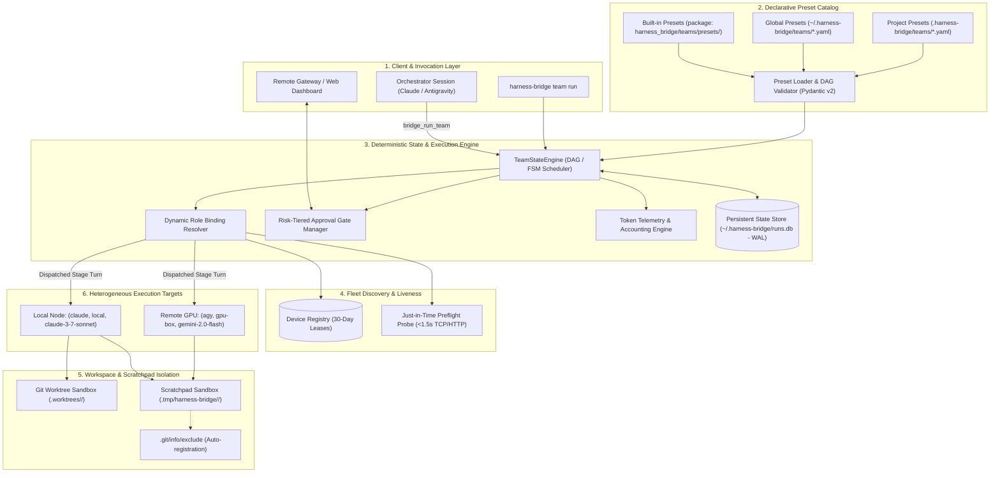

# Declarative Role & Team Preset Framework with Dynamic Fleet Binding

* **Author:** Sukumar Rastogi
* **Status:** Draft
* **Date:** 2026-11-12

---

## Overview

Harness Bridge connects disparate AI coding harnesses (`claude`, `agy`) across sessions, worktrees, and devices. While v0.1.0 established headless subprocess bridging and v0.2.0 introduced aggregated coordination rooms with a remote gateway, orchestrating complex, multi-agent workflows remains ad-hoc and brittle. Dispatched agents have no standardized roles, instructions must be manually re-prompted, topologies cannot be saved or reused, and hardware execution targets are hardcoded rather than dynamically discovered.

Harness Bridge v0.3.0 introduces a **declarative Role and Team Preset framework**. Topologies are decoupled from concrete physical machines, allowing reusable, shareable YAML presets to define roles (`architect`, `coder`, `reviewer`, `researcher`), execution constraints, and stage dependencies. Workflows are executed by a hybrid deterministic state engine and calling-session Orchestrator, dynamically binding roles to available nodes discovered via an automated registry. Stage transitions support risk-tiered human approval gates exposed via the Remote Gateway, dedicated `.tmp/` scratch spaces, standardized Markdown report envelopes for non-software domains, and granular dual-dimension token accounting with cross-run historical analytics.

---

## The Problem

1. **Ad-Hoc, Brittle Multi-Agent Coordination**: Users cannot define structured agent workflows (e.g., Triage -> Implement -> Review, or dual peer review) as versioned, reproducible templates. Every complex multi-agent execution requires manual, interactive turn-by-turn dispatch.
2. **Hardware Coupling vs. Portability**: Agent workflows created on a specific developer machine cannot easily run on a different workstation or distributed cluster because device identifiers, binary paths, and model availability differ across environments.
3. **Safety Hazards in Unattended Automation**: Automated pipelines that execute mutating actions (such as applying code diffs, merging branches, or running terminal commands) risk catastrophic side effects if left unattended or if naive fixed-window auto-proceed timers trigger without human oversight.
4. **Lack of Token Accounting & Budget Visibility**: Multi-agent sessions consume significant LLM tokens across disparate harnesses, yet developers have no visibility into what proportion of tokens each role consumes, how multiple concurrent implementers share the budget, or what historical benchmarks look like across different role-model pairings.
5. **Git Workspace Pollution for Non-Code Workflows**: Expanding Harness Bridge beyond software development (e.g., goal research, 3D modeling, technical assignments) causes throwaway scripts and intermediate data to dirty git working trees and create merge conflicts.

---

## Goals

* **Portable Team Presets**: Support declarative YAML team presets loaded with three-tier precedence: Package Built-ins < User Global (`~/.harness-bridge/teams/`) < Project Local (`.harness-bridge/teams/`).
* **Declarative Coordination DAG**: Enable presets to define workflow topologies with stages, dependencies (`depends_on`), roles, and artifact inputs/outputs.
* **Dynamic Role & Fleet Binding**: Decouple roles from static hardware by discovering available `(harness, device_id, model)` targets through automatic MCP registration leases (30-day lease) paired with fast (<1.5s) preflight liveness checks.
* **Adopt-and-Warn Orchestration**: Allow the calling agent session to initiate a team run and adopt the Orchestrator role, emitting an informational warning if its model differs from the preset's preferred configuration.
* **Risk-Tiered Human Approval Gates**: Provide non-blocking human approval gates via the Remote Gateway and CLI, where low-risk/read-only stages auto-proceed after 120s if unattended, while high-risk/mutating stages strictly pause.
* **Dual-Dimension Token Accounting**: Measure input, output, and total tokens per-role and per-session, reporting relative percentages of total run usage.
* **Historical Token Analytics**: Store telemetry in a persistent SQLite WAL database (`~/.harness-bridge/runs.db`) and expose `Role × Model` averages and percentiles across historical sessions via CLI, MCP, and Gateway.
* **Isolated Scratchpad Lifecycle**: Provide `.tmp/harness-bridge/{run_id}/` for throwaway scripts and artifacts, automatically registering it in `.git/info/exclude` to preserve clean git trees.

---

## Non-Goals

* **Autonomous Model Training or Fine-Tuning**: Harness Bridge routes tasks to models; it does not train, fine-tune, or host LLM weights.
* **Distributed Shared Memory / Distributed Filesystems**: Cross-device file transfer relies on git remotes, explicit artifact exchange, or Remote Gateway endpoints; the bridge does not implement a distributed network filesystem (e.g. NFS/Ceph).
* **Proprietary Mobile App Clients**: Gateway notifications and approvals are served via open REST/SSE endpoints and a lightweight web dashboard, avoiding dedicated iOS/Android apps.
* **Arbitrary Shell Daemon Sandboxing Outside OS Controls**: OS-level permissions remain governed by the host operating system and sandbox flags; Harness Bridge does not implement a custom kernel container runtime.

---

## Critical User Journeys (CUJs)

### CUJ 1: Collaborative Feature Delivery Swarm
* **Given**: A developer in a git repository with `harness-bridge` installed and Claude Code running.
* **When**: The developer prompts: "Launch the feature-dev team to implement OAuth2 PKCE login".
* **Then**: The Claude session calls `bridge_run_team(preset="feature-dev")`, adopts the Orchestrator role, dispatches the `architect` role to design the spec in `.tmp/`, pauses at a low-risk gate (auto-proceeding after 120s if unattended), dispatches parallel `engineer` sessions in isolated git worktrees, collects their diffs, dispatches a `verifier` to run tests, and strictly pauses at a critical gate requiring explicit human sign-off before applying code diffs to `main`.

### CUJ 2: Research & Market Comparison (Non-Code Domain)
* **Given**: An analyst working in an empty directory without a git repository.
* **When**: The user runs `harness-bridge team run deep-research --prompt "Compare GPU cloud providers for vLLM serving"`.
* **Then**: The state engine initializes `.tmp/harness-bridge/{run_id}/`, dispatches a researcher role to gather pricing data, an evaluator role to structure comparisons, and generates a standardized Markdown report with YAML metadata and frontmatter, recording token metrics and displaying a terminal report.

### CUJ 3: Cross-Run Role × Model Token Benchmarking
* **Given**: A team running various coding and research presets over several weeks.
* **When**: An engineer runs `harness-bridge analytics tokens --role architect --model claude-3-7-sonnet`.
* **Then**: The CLI queries `~/.harness-bridge/runs.db` and renders a table showing the number of sampled sessions, average total tokens per session, input/output breakdown, and P50/P90 distributions.

---

## Technical Plan (Architecture)

### 1. System Architecture Overview



---

### 2. Declarative Schema Specification

Presets are authored in declarative YAML files. A team preset contains metadata, a dictionary of logical `roles`, and a `workflow` defining stages, transitions, and approval gates.

#### Pydantic Schema Models
```python
class RoleDefinition(BaseModel):
    description: str
    instructions: str = Field(description="Role system prompt instructions")
    capabilities: list[str] = Field(default_factory=list) # e.g. ["git_worktree", "terminal_execution", "markdown_synthesis"]
    preferred_harness: Literal["claude", "agy"] | None = None
    preferred_model: str | None = None
    workspace_mode: Literal["worktree", "scratch", "inherit"] = "scratch"

class GatePolicy(BaseModel):
    risk_level: Literal["low", "critical"] = "low"
    timeout_seconds: int = 120 # 0 for indefinite pause
    timeout_action: Literal["proceed", "pause", "reject"] = "proceed"
    prompt: str = ""

class WorkflowStep(BaseModel):
    id: str
    role: str
    prompt_template: str
    depends_on: list[str] = Field(default_factory=list)
    artifact_output: str | None = None # Path template e.g. "{scratch_dir}/spec.md"
    gate: GatePolicy | None = None

class TeamPreset(BaseModel):
    schema_version: str = "0.3.0"
    team_name: str
    description: str
    orchestrator_role: str = "orchestrator"
    roles: dict[str, RoleDefinition]
    workflow: list[WorkflowStep]
```

#### Precedence Resolution Order
Presets are resolved using a 3-tier fallback strategy:
1. **Project-Local Presets**: `.harness-bridge/teams/<team_name>.yaml` (highest precedence).
2. **User-Global Presets**: `~/.harness-bridge/teams/<team_name>.yaml`.
3. **Built-in Presets**: Shipped within `harness_bridge/teams/presets/<team_name>.yaml` (`feature-dev`, `triage`, `peer-review`, `deep-research`).

---

### 3. Core Component Architecture

#### 1. Calling-Session Orchestration & Adopt-and-Warn
* When an active agent session (e.g. running under Claude Code or Antigravity) invokes `bridge_run_team(preset="feature-dev", goal="...")`, the calling session is assigned the `orchestrator_role`.
* If the calling session's detected model differs from the preset's declared `preferred_model` for the orchestrator, the tool execution succeeds but returns an informational warning banner:
  ```json
  {
    "status": "RUNNING",
    "run_id": "run-7f3b8a2c",
    "warning": "Calling session uses claude-3-5-haiku, but preset recommends claude-3-7-sonnet for orchestrator role."
  }
  ```

#### 2. Re-Entrant State Engine (`TeamStateEngine`) & SQLite WAL Store
To survive terminal crashes, client restarts, and long-running human gate waits, the execution state is backed by SQLite with Write-Ahead Logging (`~/.harness-bridge/runs.db`):

```sql
CREATE TABLE team_runs (
    run_id TEXT PRIMARY KEY,
    preset_name TEXT NOT NULL,
    status TEXT NOT NULL, -- PENDING, RUNNING, AWAITING_APPROVAL, COMPLETED, FAILED, PAUSED
    goal TEXT NOT NULL,
    orchestrator_session_id TEXT NOT NULL,
    current_step_id TEXT,
    scratch_dir TEXT NOT NULL,
    created_at REAL NOT NULL,
    updated_at REAL NOT NULL
);

CREATE TABLE step_runs (
    step_run_id TEXT PRIMARY KEY,
    run_id TEXT NOT NULL,
    step_id TEXT NOT NULL,
    role_name TEXT NOT NULL,
    session_id TEXT NOT NULL,
    device_id TEXT NOT NULL,
    harness TEXT NOT NULL,
    model TEXT NOT NULL,
    status TEXT NOT NULL, -- RUNNING, COMPLETED, FAILED, SKIPPED
    started_at REAL NOT NULL,
    completed_at REAL,
    artifact_path TEXT,
    FOREIGN KEY (run_id) REFERENCES team_runs(run_id)
);

CREATE TABLE gate_approvals (
    gate_id TEXT PRIMARY KEY,
    run_id TEXT NOT NULL,
    step_id TEXT NOT NULL,
    risk_level TEXT NOT NULL, -- low, critical
    timeout_seconds INTEGER NOT NULL,
    timeout_action TEXT NOT NULL,
    expires_at REAL NOT NULL,
    status TEXT NOT NULL, -- PENDING, APPROVED, REJECTED, AUTO_PROCEEDED, EXPIRED
    decision_by TEXT,
    decision_timestamp REAL,
    FOREIGN KEY (run_id) REFERENCES team_runs(run_id)
);
```

#### 3. Fleet Discovery & Opportunistic Preflight Probing
* **Registration Cache Lease**: Any harness executing an MCP request or running `harness-bridge ping` registers its `device_id`, available harnesses, and supported models in `device_leases` with a 30-day lease duration.
* **Preflight Probe (<1.5s Handshake)**:
  1. When assigning an execution target to a role, the Role Binder selects candidates matching the role's `preferred_harness` and `preferred_model`.
  2. If the candidate is on a remote host or separate process, a lightweight health probe ping is dispatched over HTTP/TCP.
  3. If no response is received within 1500ms, the node is marked *temporarily unreachable* for the remainder of the run, and the binder immediately routes to the next eligible candidate or the local host.

#### 4. Risk-Tiered Human Approval Gates
* When a workflow step specifies a `gate`:
  * **Low-Risk Gate** (`risk_level: "low"`): For non-destructive stages (plan review, research synthesis). Publishes an event to the Remote Gateway SSE stream. If no human intervention is received within `timeout_seconds` (default 120s), the state engine transitions the gate to `AUTO_PROCEEDED` and advances the DAG.
  * **Critical Gate** (`risk_level: "critical"`): For mutating actions (git diff merges, terminal command execution, deployment). Forces `timeout_seconds: 0` or `timeout_action: "pause"`. The engine halts step dispatch and persists state. Execution resumes only when an explicit approval is received via:
    * CLI: `harness-bridge gate approve <gate_id>`
    * MCP: `bridge_approve_gate(gate_id=..., decision="approved")`
    * Remote Gateway: `POST /api/v1/gates/{gate_id}/decision`

#### 5. Scratch Space Lifecycle (`.tmp/harness-bridge/{run_id}/`)
* On run initialization, the engine creates `.tmp/harness-bridge/{run_id}/` in the project root (or system temp directory if running outside a repository).
* If inside a git repository, the engine appends `.tmp/` to `.git/info/exclude`. This ensures that scratch files, test logs, and intermediate assets are ignored by git without modifying the user's committed `.gitignore`.

#### 6. Token Telemetry & Historical Role × Model Analytics
* During each stage turn execution, driver adapters (`claude.py`, `antigravity.py`) extract turn usage stats (`input_tokens`, `output_tokens`, `total_tokens`).
* Stored in table `token_telemetry`:
  ```sql
  CREATE TABLE token_telemetry (
      telemetry_id TEXT PRIMARY KEY,
      run_id TEXT NOT NULL,
      step_id TEXT NOT NULL,
      session_id TEXT NOT NULL,
      role_name TEXT NOT NULL,
      harness TEXT NOT NULL,
      model TEXT NOT NULL,
      input_tokens INTEGER NOT NULL DEFAULT 0,
      output_tokens INTEGER NOT NULL DEFAULT 0,
      total_tokens INTEGER NOT NULL DEFAULT 0,
      timestamp REAL NOT NULL,
      FOREIGN KEY (run_id) REFERENCES team_runs(run_id)
  );

  CREATE INDEX idx_telemetry_role_model ON token_telemetry(role_name, model);
  ```
* **Live Run Breakdown**:
  * Per-Role: `role_percentage = (SUM(role_tokens) / total_run_tokens) * 100`
  * Per-Session: `session_percentage = (SUM(session_tokens) / total_run_tokens) * 100`
* **Cross-Run Historical Benchmarks**:
  * Evaluates `AVG(total_tokens)`, `AVG(input_tokens)`, `AVG(output_tokens)`, P50, and P90 percentiles grouped by `(role_name, model)` across all recorded historical sessions in `runs.db`.

---

### 4. Interface Surface: New MCP Tools & CLI Commands

#### New Model Context Protocol (MCP) Tools
| Tool Name | Arguments | Description |
| :--- | :--- | :--- |
| `bridge_list_teams` | None | Lists available team presets discovered across built-in, global, and local scopes. |
| `bridge_inspect_team` | `preset_name: str` | Returns the parsed JSON schema, roles, and DAG topology of a preset. |
| `bridge_run_team` | `preset_name: str`, `goal: str`, `options: dict = {}` | Initiates a team run; calling session adopts the Orchestrator role. |
| `bridge_get_team_status` | `run_id: str` | Returns current FSM state, active step, pending gate, and dual-dimension token usage. |
| `bridge_approve_gate` | `gate_id: str`, `decision: Literal["approved", "rejected"]`, `feedback: str = ""` | Approves or rejects a pending human gate. |
| `bridge_get_token_analytics` | `role: str = None`, `model: str = None`, `window_days: int = 30` | Returns historical token benchmarks and averages for role/model combinations. |

#### New CLI Commands
| Command | Arguments | Description |
| :--- | :--- | :--- |
| `harness-bridge team list` | None | Displays table of available presets, sources, and roles. |
| `harness-bridge team run` | `<preset> <goal> [--require-explicit-approvals]` | Launches a team execution run from the terminal. |
| `harness-bridge team resume` | `<run_id>` | Resumes a paused or interrupted team run from SQLite state. |
| `harness-bridge team status` | `<run_id>` | Renders live ASCII/Rich DAG status, active role, and gate countdown. |
| `harness-bridge team report` | `<run_id>` | Prints the final deliverable summary, artifact paths, and dual-dimension token table. |
| `harness-bridge gate approve` | `<gate_id> [--feedback "..."]` | Submits approval for a pending gate. |
| `harness-bridge analytics tokens` | `[--role <name>] [--model <name>] [--matrix]` | Displays cross-run historical `Role × Model` token averages and percentiles. |

---

## Alternatives Considered

### 1. Blanket 120-Second Auto-Proceed vs. Risk-Tiered Gate Policies
* **Alternative Explored**: Use a universal 120-second timeout for all human approval gates, automatically advancing the workflow if no human response is received.
* **Pros**: Simple, uniform state machine logic without requiring risk classifications on stages.
* **Cons**: Severe safety hazard. Unattended auto-proceed timers advancing stages that apply code diffs, merge git branches, execute terminal commands, or invoke external APIs cause irreversible side effects without developer knowledge.
* **Reason for Rejection**: *Rejected by author: Unattended execution of mutating actions is unacceptable for production developer tooling. Risk-tiered policies safely permit auto-proceed only for read-only or exploratory stages (such as architectural reviews and research audits), while strictly pausing on mutating stages until explicit human sign-off.*

### 2. In-Memory Workflow State vs. Persistent SQLite WAL Storage
* **Alternative Explored**: Maintain running team state, stage transitions, and inboxes solely in Python in-memory objects inside `SessionManager`.
* **Pros**: Minimal architectural overhead; avoids SQLite schema management and database migrations.
* **Cons**: Harness Bridge runs as a stdio child process attached to the orchestrator session. If the parent terminal drops, restarts, or crashes during a multi-hour gate pause, all workflow state evaporates, leaving orphaned background worker sessions.
* **Reason for Rejection**: *Rejected by author: Multi-agent workflows require crash resilience and deterministic re-entrancy. SQLite in WAL mode (`~/.harness-bridge/runs.db`) provides atomic, concurrent ACID state persistence, allowing users to resume interrupted runs (`harness-bridge team resume <run_id>`) at any time.*

### 3. Continuous Background Heartbeat Daemons vs. Opportunistic Preflight Probes
* **Alternative Explored**: Require every participating machine to run a permanent background daemon broadcasting UDP/TCP heartbeats every 30 seconds to maintain a real-time availability map.
* **Pros**: Constant visibility of fleet liveness.
* **Cons**: Wastes CPU, battery, and local network traffic; fails completely if a developer forgets to start the background daemon before dispatching a team run.
* **Reason for Rejection**: *Rejected by author: Combining a 30-day static capability registration lease with an opportunistic, just-in-time preflight probe (<1.5s handshake) immediately before stage dispatch provides reliable reachability guarantees without requiring standing background daemons.*

### 4. Static Hardware Binding in YAML Presets vs. Dynamic Capability Resolution
* **Alternative Explored**: Hardcode physical node names (e.g. `machine: "sukumar-desktop"`) directly into team preset definitions.
* **Pros**: Deterministic, zero-resolution dispatch logic.
* **Cons**: Destroys preset portability. Presets cannot be committed to shared repositories, published as open-source templates, or run across diverse team environments.
* **Reason for Rejection**: *Rejected by author: Team presets must be universally shareable. Presets specify role intent, preferred harnesses, and capability constraints; the runtime engine dynamically binds these roles to registered physical nodes available in the active environment.*

### 5. OS Temp Directory vs. Project-Root `.tmp/` with Local Git Exclusion
* **Alternative Explored**: Store all scratch files, throwaway scripts, and intermediate data strictly in `/tmp/harness-bridge/<run_id>/`.
* **Pros**: Zero potential clutter within the project working tree.
* **Cons**: Difficult for developers to easily locate, inspect, or edit intermediate scratch artifacts alongside their project files; complicates relative path resolution in project-specific build tools.
* **Reason for Rejection**: *Rejected by author: Placing scratchpads at `.tmp/harness-bridge/{run_id}/` in the project root while automatically appending `.tmp/` to `.git/info/exclude` keeps scratch assets conveniently co-located with the project while guaranteeing that `git status` remains completely clean without altering committed `.gitignore` files.*

---

## Non-Functional Requirements

### Security & Privacy
* **Local Data Retention**: Token telemetry and workflow state in `~/.harness-bridge/runs.db` remain local to the user workstation, protected by standard OS user-level permissions.
* **Remote Gateway Authorization**: When approval gates are published or queried via the Remote Gateway, endpoints enforce Bearer Token authentication (as designed in v0.2.0). Unauthenticated clients cannot inspect token metrics or approve gates.
* **Execution Boundary**: Mutating stages (branch diff merges, terminal command execution) strictly prohibit automatic timeouts, preventing unattended Remote Code Execution (RCE) side effects.

### Performance & Latency
* **Preflight Probe SLA**: Dynamic role preflight checks must complete in under 1500ms; timeout immediately triggers secondary candidate or local fallback without blocking the user.
* **SQLite Concurrency (WAL)**: The state database operates in Write-Ahead Logging mode (`PRAGMA journal_mode=WAL;`), allowing concurrent reads from the Remote Gateway and CLI while the MCP server writes state transitions.
* **Token Accounting Overhead**: Telemetry extraction runs asynchronously during driver turn teardown, adding less than 5ms overhead per turn.

### Rollout & Backward Compatibility
* **Additive Architecture**: v0.3.0 introduces new MCP tools (`bridge_run_team`, `bridge_list_teams`, etc.) and does not alter existing single-turn (`bridge_dispatch_task`) or aggregated room (`bridge_join_session`) MCP contracts.
* **Schema Versioning**: Presets declare `schema_version: "0.3.0"`; the loader rejects incompatible future schema versions with actionable validation diagnostics.

---

## Detailed Implementation Plan

This section enumerates every file that will be created, modified, or updated to deliver the Role and Team Preset Framework, Re-entrant State Engine, Fleet Dynamic Binding, and Token Analytics for Harness Bridge v0.3.0.

### Enumerate Files Touched & Created

#### 1. Core Data Models: `harness_bridge/core/types.py` (Modify)
* **Changes**:
  * Define `RoleDefinition`, `GatePolicy`, `WorkflowStep`, and `TeamPreset` Pydantic models.
  * Define `StepExecutionRecord`, `GateApprovalRecord`, `DeviceLeaseRecord`.
  * Define `TokenTelemetry`, `TokenAccounting`, and `HistoricalTokenAnalytics` models.
  * Add `token_usage: dict[str, int] | None` to `TaskResult`.
* **Rationale**: Establishes strict validation contracts for YAML preset loading, state tracking, and token telemetry across all layers.

#### 2. Teams Package Definition: `harness_bridge/teams/__init__.py` (New File)
* **Changes**: Export public API functions: `load_preset`, `list_presets`, `TeamStateEngine`, `DynamicRoleBinder`.
* **Rationale**: Exposes a clean package interface for CLI and MCP server consumers.

#### 3. Preset Loader & Validator: `harness_bridge/teams/loader.py` (New File)
* **Changes**:
  * Implements `PresetLoader.load(name: str) -> TeamPreset` and `PresetLoader.list_all() -> list[PresetMetadata]`.
  * Enforces 3-tier precedence: Project (`.harness-bridge/teams/`) > Global (`~/.harness-bridge/teams/`) > Built-ins (`harness_bridge/teams/presets/`).
  * Implements DAG validation: cycle detection (using Kahn's algorithm or DFS), verifies `depends_on` references exist, and validates `initial_role` / `orchestrator_role`.
* **Rationale**: Guarantees presets are structurally sound and predictable before runtime execution.

#### 4. Persistent State Store: `harness_bridge/teams/state.py` (New File)
* **Changes**:
  * Implements `TeamStateManager` backed by SQLite with WAL mode (`~/.harness-bridge/runs.db`).
  * Creates tables: `team_runs`, `step_runs`, `gate_approvals`, `token_telemetry`, `device_leases`.
  * Provides atomic state transition methods: `create_run()`, `transition_step()`, `record_gate_decision()`, `record_telemetry()`, `get_run_state()`.
* **Rationale**: Provides ACID durability, preventing data loss when stdio child processes drop, and allowing `harness-bridge team resume <run_id>`.

#### 5. Dynamic Role & Fleet Binder: `harness_bridge/teams/binder.py` (New File)
* **Changes**:
  * Implements `DynamicRoleBinder.resolve_target(role: RoleDefinition) -> ExecutionTarget`.
  * Queries `device_leases` table for active candidates matching capability tags, preferred harness, and preferred model.
  * Dispatches opportunistic sub-1.5s TCP/HTTP preflight probes to candidate targets before dispatch.
  * Implements fallback ordering: Preferred Remote Target -> Secondary Remote Target -> Local Node.
* **Rationale**: Keeps YAML presets completely decoupled from physical workstation names while guaranteeing runtime execution viability.

#### 6. Execution State Engine: `harness_bridge/teams/engine.py` (New File)
* **Changes**:
  * Implements `TeamStateEngine.run(preset: TeamPreset, goal: str, orchestrator_session_id: str) -> str`.
  * Manages the execution loop: evaluates ready DAG steps, dispatches tasks via `SessionManager`, writes intermediate artifacts to `{scratch_dir}`, and handles gate transitions.
  * Implements risk-tiered gate policy: schedules 120s auto-proceed for `low` risk gates and enforces indefinite pause for `critical` risk gates.
  * Detects model mismatches between calling session and preset orchestrator, injecting informational warning banners.
* **Rationale**: Central coordinator orchestrating autonomous workflows across disparate agents.

#### 7. Token Telemetry & Analytics Engine: `harness_bridge/teams/telemetry.py` (New File)
* **Changes**:
  * Implements `TokenTelemetryStore.record(run_id, step_id, session_id, role, harness, model, input_tokens, output_tokens)`.
  * Computes relative percentages: `get_run_breakdown(run_id) -> TokenAccounting` (returns per-role and per-session usage).
  * Implements historical SQL aggregator: `get_role_model_benchmarks(role, model, window_days) -> HistoricalTokenAnalytics` calculating averages, sample counts, and P50/P90 distributions.
* **Rationale**: Solves token budget opacity and provides empirical data for prompt optimization and model routing.

#### 8. Built-in Preset Library: `harness_bridge/teams/presets/*.yaml` (New Files)
* **Changes**:
  * `feature-dev.yaml`: Three-role pipeline (`architect` -> `gate(low)` -> `engineer` -> `verifier` -> `gate(critical)`).
  * `triage.yaml`: Two-role pipeline (`reproducer` -> `triager`).
  * `peer-review.yaml`: Parallel fan-out (`reviewer_a`, `reviewer_b` -> `synthesizer`).
  * `deep-research.yaml`: Non-code research workflow (`scraper` -> `analyst` -> `synthesizer`).
* **Rationale**: Out-of-the-box utility for users without requiring manual YAML authoring on day one.

#### 9. Workspace Scratchpad Lifecycle: `harness_bridge/workspace/manager.py` (Modify)
* **Changes**:
  * Add `WorkspaceManager.create_scratch_space(run_id: str) -> Path`.
  * Creates `.tmp/harness-bridge/{run_id}/` in the project root.
  * Appends `.tmp/` to `.git/info/exclude` if inside a git repository, creating the exclude file if absent.
* **Rationale**: Prevents scratchpads and temporary files from polluting git status or causing checkout conflicts.

#### 10. Drivers Token Extraction: `harness_bridge/drivers/claude.py` & `antigravity.py` (Modify)
* **Changes**:
  * Parse token usage metadata from Claude Code turn output (`--output-format json` or CLI summary).
  * Parse token usage metadata from Antigravity turn results.
  * Populate `TaskResult.token_usage = {"input_tokens": X, "output_tokens": Y, "total_tokens": Z}`.
* **Rationale**: Feeds ground-truth token telemetry into the analytics engine.

#### 11. MCP Server Surface: `harness_bridge/server/mcp_server.py` (Modify)
* **Changes**:
  * Register new MCP tools: `bridge_list_teams`, `bridge_inspect_team`, `bridge_run_team`, `bridge_get_team_status`, `bridge_approve_gate`, `bridge_get_token_analytics`.
  * Register automatic MCP ping registration hook: updates `device_leases` table with calling harness and model capabilities upon any MCP interaction.
  * Implement adopt-and-warn logic when `bridge_run_team` is invoked.
* **Rationale**: Enables LLM orchestrators (Claude Code, Antigravity) to inspect, launch, monitor, and query team swarms directly through standard tool calls.

#### 12. CLI Command Suite: `harness_bridge/cli/main.py` (Modify)
* **Changes**:
  * Add `harness-bridge team` subcommands: `list`, `run`, `resume`, `status`, `report`.
  * Add `harness-bridge gate` subcommands: `approve`, `reject`.
  * Add `harness-bridge analytics tokens` command: renders dual-dimension live run breakdowns or historical `Role × Model` matrices using Rich tables.
* **Rationale**: Exposes complete developer command-line ergonomics for workflow execution and telemetry inspection.

#### 13. Comprehensive Test Suite: `tests/` (New Files)
* **Changes**:
  * `tests/test_teams.py`: Unit tests for preset loading, validation, precedence resolution, and DAG cycle detection.
  * `tests/test_team_state.py`: Unit tests for SQLite WAL persistence, FSM transitions, crash recovery, and resume.
  * `tests/test_team_telemetry.py`: Unit tests for token accounting percentages and historical SQL aggregators.
  * `tests/test_team_engine.py`: Integration test executing a multi-step team workflow with mock drivers, risk-tiered gate timeouts, and scratchpad git exclusions.
* **Rationale**: Enforces 100% test coverage and regression protection across all new execution, persistence, and telemetry paths.

#### 14. Documentation & Sitemap: `README.md` & `docs/designs/SITEMAP.md` (Modify)
* **Changes**:
  * Update `README.md` with Team Presets usage guide, CLI commands, and token analytics examples.
  * Register `docs/designs/roles_teams_and_presets.md` in `docs/designs/SITEMAP.md`.
* **Rationale**: Keeps repository documentation synchronized and discoverable.

---

### Verification Plan

* **Unit Testing (`pytest tests/`)**:
  * Test preset YAML parsing against malformed files, invalid roles, and cyclic DAG dependencies.
  * Test SQLite WAL persistence: simulate process crashes mid-stage, verify `harness-bridge team resume` recovers the exact stage state.
  * Test token math: assert role and session percentages sum to 100.0%.
  * Test historical analytics query: assert P50/P90 calculations match expected distributions across sample fixtures.
* **Integration Testing**:
  * Run simulated 3-stage team workflow (`feature-dev`) with mock Claude and Antigravity drivers.
  * Verify low-risk gate auto-proceeds after configured timeout in test harness.
  * Verify critical gate halts indefinitely until `bridge_approve_gate` is called.
  * Verify `.tmp/harness-bridge/{run_id}/` is created and verified inside `.git/info/exclude`.
* **Static Analysis & Formatting**:
  * `uv run ruff check .` (0 violations).
  * `uv run ruff format --check .` (0 format issues).

---

*Drafted with EGM*


