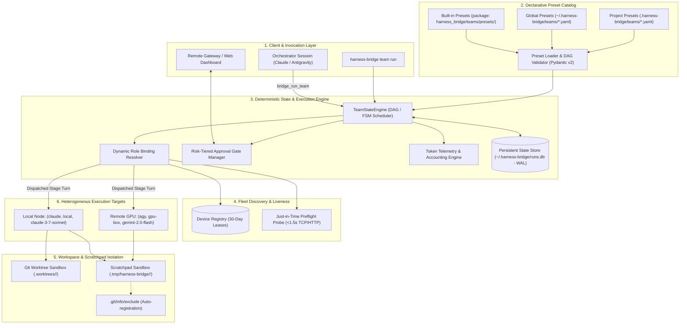

# Declarative Role & Team Preset Framework with Dynamic Fleet Binding

* **Author:** Sukumar Rastogi
* **Status:** Draft
* **Date:** 2026-11-12

---

## Overview

Harness Bridge connects disparate AI coding harnesses (`claude`, `agy`) across sessions, worktrees, and devices. While v0.1.0 established headless subprocess bridging and v0.2.0 introduced aggregated coordination rooms with a remote gateway, orchestrating complex, multi-agent workflows remains ad-hoc and brittle. Dispatched agents have no standardized roles, instructions must be manually re-prompted, topologies cannot be saved or reused, and hardware execution targets are hardcoded rather than dynamically discovered.

Harness Bridge v0.3.0 introduces a **declarative Role and Team Preset framework**. Topologies are decoupled from concrete physical machines, allowing reusable, shareable YAML presets to define roles (`architect`, `coder`, `reviewer`, `researcher`), execution constraints, and stage dependencies. Workflows are executed by a hybrid deterministic state engine and calling-session Orchestrator, dynamically binding roles to available nodes discovered via an automated registry. Stage transitions support risk-tiered human approval gates exposed via the Remote Gateway, dedicated `.tmp/` scratch spaces, standardized Markdown report envelopes for non-software domains, and granular dual-dimension token accounting with cross-run historical analytics.

---

## The Problem

1. **Ad-Hoc, Brittle Multi-Agent Coordination**: Users cannot define structured agent workflows (e.g., Triage -> Implement -> Review, or dual peer review) as versioned, reproducible templates. Every complex multi-agent execution requires manual, interactive turn-by-turn dispatch.
2. **Hardware Coupling vs. Portability**: Agent workflows created on a specific developer machine cannot easily run on a different workstation or distributed cluster because device identifiers, binary paths, and model availability differ across environments.
3. **Safety Hazards in Unattended Automation**: Automated pipelines that execute mutating actions (such as applying code diffs, merging branches, or running terminal commands) risk catastrophic side effects if left unattended or if naive fixed-window auto-proceed timers trigger without human oversight.
4. **Lack of Token Accounting & Budget Visibility**: Multi-agent sessions consume significant LLM tokens across disparate harnesses, yet developers have no visibility into what proportion of tokens each role consumes, how multiple concurrent implementers share the budget, or what historical benchmarks look like across different role-model pairings.
5. **Git Workspace Pollution for Non-Code Workflows**: Expanding Harness Bridge beyond software development (e.g., goal research, 3D modeling, technical assignments) causes throwaway scripts and intermediate data to dirty git working trees and create merge conflicts.

---

## Goals

* **Portable Team Presets**: Support declarative YAML team presets loaded with three-tier precedence: Package Built-ins < User Global (`~/.harness-bridge/teams/`) < Project Local (`.harness-bridge/teams/`).
* **Declarative Coordination DAG**: Enable presets to define workflow topologies with stages, dependencies (`depends_on`), roles, and artifact inputs/outputs.
* **Dynamic Role & Fleet Binding**: Decouple roles from static hardware by discovering available `(harness, device_id, model)` targets through automatic MCP registration leases (30-day lease) paired with fast (<1.5s) preflight liveness checks.
* **Adopt-and-Warn Orchestration**: Allow the calling agent session to initiate a team run and adopt the Orchestrator role, emitting an informational warning if its model differs from the preset's preferred configuration.
* **Risk-Tiered Human Approval Gates**: Provide non-blocking human approval gates via the Remote Gateway and CLI, where low-risk/read-only stages auto-proceed after 120s if unattended, while high-risk/mutating stages strictly pause.
* **Dual-Dimension Token Accounting**: Measure input, output, and total tokens per-role and per-session, reporting relative percentages of total run usage.
* **Historical Token Analytics**: Store telemetry in a persistent SQLite WAL database (`~/.harness-bridge/runs.db`) and expose `Role × Model` averages and percentiles across historical sessions via CLI, MCP, and Gateway.
* **Isolated Scratchpad Lifecycle**: Provide `.tmp/harness-bridge/{run_id}/` for throwaway scripts and artifacts, automatically registering it in `.git/info/exclude` to preserve clean git trees.

---

## Non-Goals

* **Autonomous Model Training or Fine-Tuning**: Harness Bridge routes tasks to models; it does not train, fine-tune, or host LLM weights.
* **Distributed Shared Memory / Distributed Filesystems**: Cross-device file transfer relies on git remotes, explicit artifact exchange, or Remote Gateway endpoints; the bridge does not implement a distributed network filesystem (e.g. NFS/Ceph).
* **Proprietary Mobile App Clients**: Gateway notifications and approvals are served via open REST/SSE endpoints and a lightweight web dashboard, avoiding dedicated iOS/Android apps.
* **Arbitrary Shell Daemon Sandboxing Outside OS Controls**: OS-level permissions remain governed by the host operating system and sandbox flags; Harness Bridge does not implement a custom kernel container runtime.

---

## Critical User Journeys (CUJs)

### CUJ 1: Collaborative Feature Delivery Swarm
* **Given**: A developer in a git repository with `harness-bridge` installed and Claude Code running.
* **When**: The developer prompts: "Launch the feature-dev team to implement OAuth2 PKCE login".
* **Then**: The Claude session calls `bridge_run_team(preset_name="feature-dev", goal="Implement OAuth2 PKCE login")`, adopts the Orchestrator role, dispatches the `architect` role to design the spec in `.tmp/`, pauses at a low-risk gate (auto-proceeding after 120s if unattended), dispatches the `engineer` role to implement changes in an isolated git worktree, collects diffs, dispatches the `verifier` to run tests, and strictly pauses at a critical gate requiring explicit human sign-off before applying code diffs to `main`.

### CUJ 2: Research & Market Comparison (Non-Code Domain)
* **Given**: An analyst working in an empty directory without a git repository.
* **When**: The user runs `harness-bridge team run deep-research --prompt "Compare GPU cloud providers for vLLM serving"`.
* **Then**: The state engine initializes `.tmp/harness-bridge/{run_id}/`, dispatches a researcher role to gather pricing data, an evaluator role to structure comparisons, and generates a standardized Markdown report with YAML metadata and frontmatter, recording token metrics and displaying a terminal report.

### CUJ 3: Cross-Run Role × Model Token Benchmarking
* **Given**: A team running various coding and research presets over several weeks.
* **When**: An engineer runs `harness-bridge analytics tokens --role architect --model claude-3-7-sonnet`.
* **Then**: The CLI queries `~/.harness-bridge/runs.db` and renders a table showing the number of sampled sessions, average total tokens per session, input/output breakdown, and P50/P90 distributions.

---

## Technical Plan (Architecture)

### 1. System Architecture Overview



---

### 2. Declarative Schema Specification

Presets are authored in declarative YAML files. A team preset contains metadata, a dictionary of logical `roles`, and a `workflow` defining stages, transitions, and approval gates.

#### Sample YAML Preset: `feature-dev.yaml`
```yaml
schema_version: "0.3.0"
team_name: "feature-dev"
description: "Three-role collaborative feature development pipeline with architecture, implementation, and verification gates."
orchestrator_role: "orchestrator"

roles:
  architect:
    description: "System Architect producing design specifications and API contracts."
    instructions: "You are the Architect. Analyze the goal, design modular component boundaries, and write a detailed design specification."
    capabilities: ["markdown_synthesis"]
    preferred_harness: "claude"
    preferred_model: "claude-3-7-sonnet"
    workspace_mode: "scratch"

  engineer:
    description: "Senior Software Engineer implementing features and tests in git worktrees."
    instructions: "You are the Implementer. Read the architectural specification and implement complete code changes with tests."
    capabilities: ["git_worktree", "terminal_execution"]
    preferred_harness: "claude"
    preferred_model: "claude-3-7-sonnet"
    workspace_mode: "worktree"

  verifier:
    description: "Quality & Test Engineer verifying implementation against specifications."
    instructions: "You are the Verifier. Inspect git diffs and execute automated tests to verify correct behavior."
    capabilities: ["terminal_execution"]
    preferred_harness: "agy"
    preferred_model: "gemini-2.0-flash"
    workspace_mode: "worktree"

workflow:
  - id: "design"
    role: "architect"
    prompt_template: "Design the technical architecture and interface contracts for: {goal}. Write output to {scratch_dir}/spec.md. {feedback}"
    depends_on: []
    artifact_output: "{scratch_dir}/spec.md"
    timeout_seconds: 300
    gate:
      risk_level: "low"
      timing: "post"
      timeout_seconds: 120
      timeout_action: "proceed"
      prompt: "Approve architectural specification at {scratch_dir}/spec.md?"

  - id: "implement"
    role: "engineer"
    prompt_template: "Implement the feature according to specification in {steps.design.artifact_path}. {feedback}"
    depends_on: ["design"]
    timeout_seconds: 600

  - id: "verify"
    role: "verifier"
    prompt_template: "Run unit and integration test suites against branch changes. Summary: {steps.implement.output}"
    depends_on: ["implement"]
    timeout_seconds: 300
    gate:
      risk_level: "critical"
      timing: "post"
      timeout_seconds: 0
      timeout_action: "pause"
      on_reject: "implement"
      max_attempts: 3
      prompt: "Sign off verification tests before merging branch diffs to main?"
```

#### Pydantic Schema Models
```python
class RoleDefinition(BaseModel):
    description: str
    instructions: str = Field(description="Role system prompt instructions")
    capabilities: list[str] = Field(default_factory=list) # e.g. ["git_worktree", "terminal_execution", "markdown_synthesis"]
    preferred_harness: Literal["claude", "agy"] | None = None
    preferred_model: str | None = None
    workspace_mode: Literal["worktree", "scratch", "inherit"] = "scratch"

class GatePolicy(BaseModel):
    risk_level: Literal["low", "critical"] = "low"
    timing: Literal["post", "pre"] = Field(
        default="post",
        description="Timing relative to step execution: 'post' validates completed deliverable before unblocking dependents; 'pre' gates starting step execution."
    )
    timeout_seconds: int = Field(default=120, description="Auto-proceed timeout window. 0 for strict blocking pause.")
    timeout_action: Literal["proceed", "pause", "reject"] = Field(
        default="proceed",
        description="Action upon timeout expiration. Enforced to 'pause' for critical gates."
    )
    prompt: str = ""
    on_reject: str | None = Field(
        default=None,
        description="Target StepId to roll back to upon rejection (recursively resets downstream dependents)."
    )
    max_attempts: int = Field(
        default=3,
        description="Maximum rollback attempts permitted before automatically pausing the workflow with an alert."
    )

    @model_validator(mode="after")
    def validate_gate_safety_defaults(self) -> "GatePolicy":
        if self.risk_level == "critical":
            if self.timeout_action == "proceed":
                # Default critical gates to pause and indefinite wait
                self.timeout_action = "pause"
                self.timeout_seconds = 0
            elif self.timeout_action == "pause":
                self.timeout_seconds = 0
            elif self.timeout_action == "reject":
                # Explicit rejection timeout permitted (e.g. CI failure timeout)
                pass
        elif self.risk_level == "low":
            if not self.timeout_action:
                self.timeout_action = "proceed"
        return self

class WorkflowStep(BaseModel):
    id: str
    role: str
    prompt_template: str
    depends_on: list[str] = Field(default_factory=list)
    artifact_output: str | None = None # Path template e.g. "{scratch_dir}/spec.md"
    timeout_seconds: int = Field(default=300, description="Execution timeout in seconds for this step.")
    gate: GatePolicy | None = None

class TeamPreset(BaseModel):
    schema_version: str = "0.3.0"
    team_name: str
    description: str
    orchestrator_role: str | None = "orchestrator"
    roles: dict[str, RoleDefinition]
    workflow: list[WorkflowStep]

class RoleTokenBreakdown(BaseModel):
    input_tokens: int = 0
    output_tokens: int = 0
    total_tokens: int = 0
    cached_tokens: int = 0
    percentage: float = 0.0

class SessionTokenBreakdown(BaseModel):
    role_name: str
    harness: str
    model: str
    input_tokens: int = 0
    output_tokens: int = 0
    total_tokens: int = 0
    cached_tokens: int = 0
    percentage: float = 0.0

class TokenAccounting(BaseModel):
    run_id: str
    total_run_tokens: int = 0
    by_role: dict[str, RoleTokenBreakdown] = Field(default_factory=dict)
    by_session: dict[str, SessionTokenBreakdown] = Field(default_factory=dict)

class HistoricalTokenAnalytics(BaseModel):
    role: str
    model: str
    sample_count: int = 0
    avg_total_tokens: float = 0.0
    avg_input_tokens: float = 0.0
    avg_output_tokens: float = 0.0
    avg_cached_tokens: float = 0.0
    p50_total: float = 0.0
    p90_total: float = 0.0
```

#### Template Interpolation Context & Validation
Step prompts and artifact paths support standard Python `str.format_map` interpolation against runtime execution context:
* `{goal}`: The top-level goal string supplied at team initiation.
* `{run_id}`: The unique identifier of the active team execution.
* `{scratch_dir}`: The absolute path to `.tmp/harness-bridge/{run_id}/`.
* `{step_id}`: The current step identifier.
* `{feedback}`: Rejection guidance string provided by human reviewer on stage rollback (defaults to empty string `""` on initial attempt 1).
* `{steps.<step_id>.artifact_path}`: Absolute path to deliverables produced by upstream dependency steps.
* `{steps.<step_id>.output}`: Summary text returned by completed upstream dependency steps.

**Dependency Alignment Invariant**: `PresetLoader` parses prompt templates during preset ingestion and verifies that any `{steps.<step_id>...}` references strictly correspond to step IDs declared in that step's `depends_on` list. Undeclared dependencies trigger a validation error before run execution.

**Remote Target Template Scoping**: For steps dispatched to remote worker nodes, the host engine avoids evaluating filesystem-specific variables (`{scratch_dir}`, `{steps.<step_id>.artifact_path}`) with host-local absolute paths. Instead, `POST /api/v1/dispatch` transmits the un-interpolated prompt template and relative artifact filenames. The remote worker creates its local scratchpad `.tmp/harness-bridge/{run_id}/`, downloads required upstream artifacts via `GET /api/v1/runs/{run_id}/artifacts/{name}`, and performs template interpolation locally against its own scratch directory. This guarantees all file path references in prompts match the remote worker's local filesystem.

#### Precedence Resolution Order
Presets are resolved using a 3-tier fallback strategy (discovering both `*.yaml` and `*.yml` extensions):
1. **Project-Local Presets**: `.harness-bridge/teams/<team_name>.yaml` (highest precedence).
2. **User-Global Presets**: `~/.harness-bridge/teams/<team_name>.yaml`.
3. **Built-in Presets**: Shipped within `harness_bridge/teams/presets/<team_name>.yaml` (`feature-dev`, `triage`, `peer-review`, `deep-research`).

---

### 3. Core Component Architecture

#### 1. Calling-Session Orchestration, Standalone CLI Mode & Asynchronous Execution
* **Asynchronous Dispatch Lifecycle**:
  * Tool `bridge_run_team(preset="...", goal="...")` operates strictly as an **asynchronous job spawner**. It initializes the FSM in SQLite, provisions `.tmp/`, starts the background DAG runner task, and immediately returns a response envelope containing `run_id`, initial state (`"running"`), and the active step metadata.
  * Multi-agent runs frequently wait hours at human approval gates. Non-blocking dispatch prevents stdio MCP connection timeouts (typically 60-300s in Claude Code / Antigravity).
  * The calling orchestrator inspects progress via `bridge_get_team_status(run_id)` or subscribes to Remote Gateway Server-Sent Events (SSE).
* **Dual Orchestration Modes**:
  * **Calling-Session Mode (MCP)**: When initiated by an active agent session via MCP, the calling session adopts the `orchestrator_role`.
    * **Caller Model Discovery**: To verify model alignment without MCP protocol extensions, the bridge checks:
      1. `options.get("caller_model")` explicitly supplied by the caller in `bridge_run_team`.
      2. Parent process environment variables (`CLAUDE_MODEL`, `ANTHROPIC_MODEL`, `GEMINI_MODEL`, `HARNESS_BRIDGE_MODEL`).
      3. If undetermined, the warning banner is suppressed to avoid false alarms.
    * If a mismatch is detected against the preset's declared `preferred_model` for the orchestrator, execution proceeds with an informational warning banner:
      ```json
      {
        "status": "running",
        "run_id": "run-7f3b8a2c",
        "warning": "Calling session uses claude-3-5-haiku, but preset recommends claude-3-7-sonnet for orchestrator role."
      }
      ```
  * **Standalone Engine Mode (CLI)**: When launched via terminal (`harness-bridge team run`), the engine operates standalone. The deterministic `TeamStateEngine` evaluates DAG dependencies and dispatches worker roles directly without requiring an ambient LLM orchestrator session unless the preset defines specific DAG steps for the orchestrator role.
* **Dynamic Event-Driven Step Concurrency**:
  * In DAG topologies with independent branches of unequal duration, monolithic `asyncio.gather` barriers cause head-of-line blocking (e.g. a fast 5s branch being blocked from unblocking downstream steps by a slow 60s sibling branch).
  * `TeamStateEngine` evaluates the DAG dynamically via an event-driven task loop: as each step finishes, its downstream dependents with satisfied prerequisites are immediately scheduled and executed. Active concurrent steps are queried dynamically from `step_runs WHERE status = 'running'`, avoiding race conditions.

#### 2. Re-Entrant State Engine (`TeamStateEngine`) & SQLite WAL Store
To survive terminal crashes, client restarts, and long-running human gate waits, the execution state is backed by SQLite with Write-Ahead Logging (`~/.harness-bridge/runs.db`). All database connections strictly enforce:
* `PRAGMA journal_mode = WAL;` (concurrent reader-writer access)
* `PRAGMA busy_timeout = 5000;` (5-second lock acquisition timeout)
* `PRAGMA foreign_keys = ON;` (relational integrity constraint enforcement)

```sql
CREATE TABLE team_runs (
    run_id TEXT PRIMARY KEY,
    preset_name TEXT NOT NULL,
    status TEXT NOT NULL, -- pending, running, awaiting_approval, completed, failed, paused
    goal TEXT NOT NULL,
    orchestrator_session_id TEXT NOT NULL,
    scratch_dir TEXT NOT NULL,
    created_at REAL NOT NULL,
    updated_at REAL NOT NULL
);

CREATE TABLE step_runs (
    step_run_id TEXT PRIMARY KEY,
    run_id TEXT NOT NULL,
    step_id TEXT NOT NULL,
    role_name TEXT NOT NULL,
    session_id TEXT, -- Nullable while status='pending' before dispatch
    device_id TEXT,  -- Nullable while status='pending' before dynamic binding
    harness TEXT,    -- Nullable while status='pending'
    model TEXT,      -- Nullable while status='pending'
    status TEXT NOT NULL, -- pending, running, awaiting_gate, completed, failed, skipped
    started_at REAL, -- Nullable while status='pending'
    completed_at REAL,
    artifact_path TEXT,
    output TEXT, -- Driver turn summary text for {steps.<step_id>.output} interpolation
    error_message TEXT,
    exit_code INTEGER NOT NULL DEFAULT 0,
    attempt_number INTEGER NOT NULL DEFAULT 1,
    FOREIGN KEY (run_id) REFERENCES team_runs(run_id)
);

CREATE TABLE gate_approvals (
    gate_id TEXT PRIMARY KEY,
    run_id TEXT NOT NULL,
    step_id TEXT NOT NULL,
    attempt_number INTEGER NOT NULL DEFAULT 1,
    timing TEXT NOT NULL DEFAULT 'post', -- pre, post
    risk_level TEXT NOT NULL, -- low, critical
    timeout_seconds INTEGER NOT NULL,
    timeout_action TEXT NOT NULL, -- pause, proceed, reject
    expires_at REAL NOT NULL,
    status TEXT NOT NULL, -- pending, approved, rejected, auto_proceeded, expired
    decision_by TEXT,
    decision_timestamp REAL,
    feedback TEXT,
    FOREIGN KEY (run_id) REFERENCES team_runs(run_id)
);

CREATE TABLE device_leases (
    device_id TEXT NOT NULL,
    harness TEXT NOT NULL,
    model TEXT NOT NULL,
    capabilities_json TEXT NOT NULL DEFAULT '[]',
    gateway_endpoint TEXT,
    auth_token TEXT, -- Bearer token for remote gateway authorization
    lease_expires_at REAL NOT NULL,
    last_seen_at REAL NOT NULL,
    PRIMARY KEY (device_id, harness, model)
);

CREATE INDEX idx_step_runs_run_id ON step_runs(run_id);
CREATE INDEX idx_step_runs_run_step ON step_runs(run_id, step_id);
CREATE INDEX idx_gate_approvals_run_id ON gate_approvals(run_id);
CREATE INDEX idx_device_leases_expires ON device_leases(lease_expires_at);
```

#### 3. Fleet Discovery, Remote RPC Dispatch & Artifact Exchange
* **Registration Cache Lease & Discovery Handshake**:
  * Any harness executing an MCP request or running `harness-bridge fleet register <gateway_url> [--token <secret>]` (or calling MCP tool `bridge_register_target`) queries the remote gateway's discovery endpoint (`GET /api/v1/info` or `GET /health` with Bearer authorization).
  * The remote gateway responds with a structured discovery envelope:
    ```json
    {
      "status": "healthy",
      "device_id": "gpu-box-01",
      "harnesses": ["agy", "claude"],
      "models": ["gemini-2.0-flash", "claude-3-7-sonnet"],
      "capabilities": ["gpu", "terminal_execution"]
    }
    ```
  * The local bridge registers each available `(device_id, harness, model)` tuple in `device_leases` with `capabilities_json`, `gateway_endpoint`, `auth_token`, and a 30-day lease duration.
* **Preflight Probe (<1.5s Handshake)**:
  1. When assigning an execution target to a role, the Role Binder selects candidates matching the role's `preferred_harness` and `preferred_model`, prioritizing the local node if capabilities and models match to avoid unnecessary network latency.
  2. If the candidate is on a remote machine, the binder sends an opportunistic health probe to the remote host's authenticated Remote Gateway daemon endpoint (`GET /health` on port 8765, as specified in v0.2.0 `docs/designs/aggregated_sessions_and_remote_gateway.md`).
  3. If no response is received within 1500ms, the node is marked *temporarily unreachable* for the remainder of the run, and the binder immediately falls back to secondary candidates or the local node.
* **Host Gateway Daemon Preflight Check & URL Resolution**:
  * Before dispatching tasks to remote workers, `TeamStateEngine` verifies that the local Remote Gateway daemon is running and reachable. Remote workers connect back to the host gateway to download upstream artifacts and post completion results. If the host gateway is inactive, the engine automatically launches an ephemeral local gateway daemon or halts with a clear error prompt (`harness-bridge gateway start`).
  * The engine resolves the routable `host_gateway_url` using the following precedence:
    1. Explicit CLI argument (`--gateway-url <url>`) or MCP option.
    2. Environment variable `HARNESS_BRIDGE_GATEWAY_URL`.
    3. Auto-detected routable IP: checks for an active VPN/overlay IP (e.g. Tailscale `100.*.*.*`) or primary non-loopback network interface IP.
    4. **Loopback Guard**: If `host_gateway_url` resolves to loopback (`127.0.0.1` or `localhost`) when dispatching to a remote node, the engine halts dispatch with an actionable error prompt instructing the user to configure `HARNESS_BRIDGE_GATEWAY_URL` or `--gateway-url` to a routable IP address.
* **Remote Dispatch & Artifact Exchange RPC Protocol**:
  * Because Harness Bridge strictly enforces a non-distributed filesystem boundary (Section Non-Goals), remote workers cannot directly mount or write to the host's `.tmp/harness-bridge/{run_id}/` scratchpad.
  * Remote execution is coordinated via authenticated REST endpoints exposed by the Remote Gateway:
    * `POST /api/v1/dispatch`: Host posts task specifications (`run_id`, `step_id`, `goal`, `role`, `prompt_template`, `context: dict = {}`, `artifacts: list[str] = []`, `host_gateway_url`, `auth_token`, `timeout_seconds: int = 300`) to the remote worker gateway. The `artifacts` manifest lists all upstream dependency deliverable filenames required for the step.
    * The remote worker provisions its local scratchpad `.tmp/harness-bridge/{run_id}/`, downloads upstream dependency artifacts via `GET /api/v1/runs/{run_id}/artifacts/{name}`, and performs template interpolation locally so that `{scratch_dir}` and `{steps.<step_id>.artifact_path}` resolve to its local filesystem paths.
    * `GET /api/v1/runs/{run_id}/artifacts/{name}`: Remote worker downloads upstream dependency artifacts from host scratchpad before starting.
    * `POST /api/v1/runs/{run_id}/artifacts/{name}`: Remote worker uploads its completed deliverable (e.g. `spec.md`, report) to the host gateway, which saves it into `.tmp/harness-bridge/{run_id}/`.
    * **Path Traversal Protection**: Both artifact endpoints strictly sanitize `{name}` using `os.path.basename` and verify `(scratch_dir / name).resolve().is_relative_to(scratch_dir.resolve())`. Requests attempting directory escape (e.g. `../../etc/passwd`) are rejected with HTTP 400 Bad Request.
    * `POST /api/v1/runs/{run_id}/steps/{step_id}/complete`: Remote worker signals turn completion back to host gateway, transmitting execution summary and token telemetry:
      ```json
      {
        "status": "completed",
        "exit_code": 0,
        "output": "Driver turn summary text...",
        "token_usage": {
          "input_tokens": 1240,
          "output_tokens": 450,
          "total_tokens": 1690,
          "cached_tokens": 0
        },
        "artifact_name": "spec.md"
      }
      ```
* **Step Execution Timeout**:
  * The engine enforces `WorkflowStep.timeout_seconds` (default 300s) on all step executions (both local and remote). If a task execution exceeds this duration, the runner terminates the process/session, records `exit_code: -1`, sets `error_message: "Step timed out after {timeout_seconds}s"`, and transitions the step to `"failed"`.

#### 4. Risk-Tiered Human Approval Gates & Recursive Rejection Rollback
* When a workflow step specifies a `gate`:
  * **Gate Timing**: Evaluated according to `timing` attribute (defaulting to `"post"`):
    * `"post"` (Default): Validates the completed step's generated artifact before unblocking downstream DAG dependencies.
    * `"pre"`: Halts execution before the step starts, requiring approval to begin (e.g. approving cost or resource allocation).
  * **Low-Risk Gate** (`risk_level: "low"`): Defaults `timeout_action: "proceed"` and `timeout_seconds: 120`. Publishes an event to the Remote Gateway SSE stream. If unattended, the engine transitions the gate to `"auto_proceeded"` and unblocks the DAG.
  * **Critical Gate** (`risk_level: "critical"`): Strictly enforces `timeout_action: "pause"` and `timeout_seconds: 0`. The engine halts step dispatch and persists state. Execution resumes only when an explicit approval is received via CLI, MCP, or Gateway.
* **FSM Rejection, Rollback Ceiling & Stale Artifact Pruning**:
  * When a gate receives a rejection (`decision="rejected"`):
    1. The gate record status transitions to `"rejected"`.
    2. If the step's `GatePolicy` defines an `on_reject: "<step_id>"` target:
       * **Rollback Ceiling Guard**: Check `attempt_number <= max_attempts` (default 3). If `attempt_number > max_attempts`, the engine halts rollback to avoid unbounded token consumption, transitions team run status to `"paused"` with an alert (`Rollback ceiling exceeded for step '{step_id}'`), and awaits human CLI intervention (`harness-bridge team resume`).
       * The engine resets the target step to `"pending"`, increments its `attempt_number`, and injects the rejection `feedback` into its prompt template.
       * **Recursive Transitive Invalidation & Stale Artifact Pruning**: To preserve DAG integrity, the engine recursively traverses the dependency graph downstream from the target step, marking all dependent steps that were previously `"completed"` back to `"pending"`. Additionally, the engine unlinks/deletes declared `artifact_output` files in `{scratch_dir}` for all invalidated downstream steps. This guarantees that downstream workers re-execute against fresh upstream deliverables and cannot falsely pass completion assertions on stale artifacts.
    3. If `on_reject` is absent, the engine transitions the team run status to `"paused"` and awaits human CLI intervention (`harness-bridge team resume`).

#### 5. Scratch Space Lifecycle, Git Exclusion & Retention Pruning
* On run initialization, the engine creates `.tmp/harness-bridge/{run_id}/` in the project root (or system temp directory if running outside a git repository).
* **Git Exclusion Guard**: If `git rev-parse --is-inside-work-tree` confirms the process is inside a git repository, the engine resolves the exclude path using `git rev-parse --git-path info/exclude` (handling both regular `.git` folders and `.worktrees/<session_id>/` pointer files). It ensures the file ends with a trailing newline before appending `.tmp/` if not already present.
* **Retention Pruning**: To prevent unbounded directory accumulation in `.tmp/`, the engine automatically prunes scratch directories older than 7 days during run initialization. Users can trigger manual cleanup via `harness-bridge clean [--days N]`.

#### 6. Token Telemetry & Historical Role × Model Analytics
* Drivers populate a structured `TokenUsage` model:
  ```python
  class TokenUsage(BaseModel):
      input_tokens: int = 0
      output_tokens: int = 0
      total_tokens: int = 0
      cached_tokens: int = 0
  ```
* Stored in table `token_telemetry`:
  ```sql
  CREATE TABLE token_telemetry (
      telemetry_id TEXT PRIMARY KEY,
      run_id TEXT NOT NULL,
      step_id TEXT NOT NULL,
      session_id TEXT NOT NULL,
      role_name TEXT NOT NULL,
      harness TEXT NOT NULL,
      model TEXT NOT NULL,
      input_tokens INTEGER NOT NULL DEFAULT 0,
      output_tokens INTEGER NOT NULL DEFAULT 0,
      total_tokens INTEGER NOT NULL DEFAULT 0,
      cached_tokens INTEGER NOT NULL DEFAULT 0,
      timestamp REAL NOT NULL,
      FOREIGN KEY (run_id) REFERENCES team_runs(run_id)
  );

  CREATE INDEX idx_telemetry_run_id ON token_telemetry(run_id);
  CREATE INDEX idx_telemetry_role_model ON token_telemetry(role_name, model);
  ```
* **Zero-Safe Relative Percentages**:
  * `role_percentage = (SUM(role_tokens) / total_run_tokens * 100.0) if total_run_tokens > 0 else 0.0`
  * `session_percentage = (SUM(session_tokens) / total_run_tokens * 100.0) if total_run_tokens > 0 else 0.0`
* **Cross-Run Historical Benchmarks**:
  * Evaluates `AVG(total_tokens)`, `AVG(input_tokens)`, `AVG(output_tokens)`, and `AVG(cached_tokens)` grouped by `(role_name, model)` across historical sessions in `runs.db`.
  * Quantile metrics (P50 and P90 percentiles) are calculated in Python via `statistics.quantiles` over ordered token counts queried from SQLite with sample-size guards: returns `0.0` for `len(data) == 0`, `data[0]` for `len(data) == 1`, and `statistics.quantiles(data, n=100)` for `len(data) >= 2`.

---

### 4. Interface Surface: New MCP Tools & CLI Commands

#### New Model Context Protocol (MCP) Tools
| Tool Name | Arguments | Description |
| :--- | :--- | :--- |
| `bridge_list_teams` | None | Lists available team presets discovered across built-in, global, and local scopes. |
| `bridge_inspect_team` | `preset_name: str` | Returns the parsed JSON schema, roles, and DAG topology of a preset. |
| `bridge_run_team` | `preset_name: str`, `goal: str`, `options: dict = {}` | Asynchronously initiates a team run; returns immediately with `run_id`, `status: "running"`, and active step metadata. |
| `bridge_get_team_status` | `run_id: str` | Returns current FSM state, active steps (`active_steps: list[str]`), pending gate, and dual-dimension token usage. |
| `bridge_pause_team` | `run_id: str` | Pauses an active team run, holding state in SQLite. |
| `bridge_resume_team` | `run_id: str` | Resumes a paused team run from SQLite state. |
| `bridge_cancel_team` | `run_id: str`, `reason: str = ""` | Gracefully cancels an active team run, halts background tasks, and marks status `"failed"`. |
| `bridge_approve_gate` | `gate_id: str`, `decision: Literal["approved", "rejected"] = "approved"`, `feedback: str = ""` | Submits approval decision for a pending gate with optional guidance feedback. |
| `bridge_reject_gate` | `gate_id: str`, `feedback: str = ""` | Explicit tool to reject a pending gate with guidance feedback, triggering rollback or pause. |
| `bridge_register_target` | `gateway_url: str`, `token: str = ""` | Registers a remote node's gateway with the local bridge's `device_leases` registry. |
| `bridge_get_token_analytics` | `role: str | None = None`, `model: str | None = None`, `window_days: int = 30` | Returns historical token benchmarks and averages for role/model combinations. |

#### New CLI Commands
| Command | Arguments | Description |
| :--- | :--- | :--- |
| `harness-bridge team list` | None | Displays table of available presets, sources, and roles. |
| `harness-bridge team inspect` | `<preset>` | Displays parsed YAML schema, role definitions, and DAG topology for a preset. |
| `harness-bridge team run` | `<preset> [goal] [-p/--prompt <text>] [--require-explicit-approvals]` | Launches a team execution run from the terminal (standalone engine mode). |
| `harness-bridge team resume` | `<run_id>` | Resumes a paused or interrupted team run from SQLite state. |
| `harness-bridge team pause` | `<run_id>` | Pauses an active team run, holding state in SQLite. |
| `harness-bridge team abort` | `<run_id>` | Aborts an active team run and terminates running subprocesses (alias: `team cancel`). |
| `harness-bridge team status` | `<run_id>` | Renders live ASCII/Rich DAG status, active role, and gate countdown. |
| `harness-bridge team report` | `<run_id>` | Prints the final deliverable summary, artifact paths, and dual-dimension token table. |
| `harness-bridge gate approve` | `<gate_id> [--feedback "..."]` | Submits approval for a pending gate. |
| `harness-bridge gate reject` | `<gate_id> [--feedback "..."]` | Rejects a pending gate, triggering `on_reject` rollback or pausing execution. |
| `harness-bridge fleet register` | `<gateway_url> [--token <secret>]` | Registers a remote node's gateway into local `device_leases`. |
| `harness-bridge clean` | `[--days N]` | Prunes project scratch directories under `.tmp/harness-bridge/` older than N days (default 7). |
| `harness-bridge analytics tokens` | `[--role <name>] [--model <name>] [--matrix] [--days N]` | Displays cross-run historical `Role × Model` token averages and percentiles over N days (default 30). |

---

## Alternatives Considered

### 1. Blanket 120-Second Auto-Proceed vs. Risk-Tiered Gate Policies
* **Alternative Explored**: Use a universal 120-second timeout for all human approval gates, automatically advancing the workflow if no human response is received.
* **Pros**: Simple, uniform state machine logic without requiring risk classifications on stages.
* **Cons**: Severe safety hazard. Unattended auto-proceed timers advancing stages that apply code diffs, merge git branches, execute terminal commands, or invoke external APIs cause irreversible side effects without developer knowledge.
* **Reason for Rejection**: *Rejected by author: Unattended execution of mutating actions is unacceptable for production developer tooling. Risk-tiered policies safely permit auto-proceed only for read-only or exploratory stages (such as architectural reviews and research audits), while strictly pausing on mutating stages until explicit human sign-off.*

### 2. In-Memory Workflow State vs. Persistent SQLite WAL Storage
* **Alternative Explored**: Maintain running team state, stage transitions, and inboxes solely in Python in-memory objects inside `SessionManager`.
* **Pros**: Minimal architectural overhead; avoids SQLite schema management and database migrations.
* **Cons**: Harness Bridge runs as a stdio child process attached to the orchestrator session. If the parent terminal drops, restarts, or crashes during a multi-hour gate pause, all workflow state evaporates, leaving orphaned background worker sessions.
* **Reason for Rejection**: *Rejected by author: Multi-agent workflows require crash resilience and deterministic re-entrancy. SQLite in WAL mode (`~/.harness-bridge/runs.db`) provides atomic, concurrent ACID state persistence, allowing users to resume interrupted runs (`harness-bridge team resume <run_id>`) at any time.*

### 3. Continuous Background Heartbeat Daemons vs. Opportunistic Preflight Probes
* **Alternative Explored**: Require every participating machine to run a permanent background daemon continuously broadcasting UDP/TCP heartbeats every 30 seconds to maintain a real-time availability map.
* **Pros**: Constant visibility of fleet liveness.
* **Cons**: Wastes CPU, battery, and local network traffic; fails completely if a developer forgets to start the broadcast daemon before dispatching a team run.
* **Reason for Rejection**: *Rejected by author: Continuous broadcast heartbeats are unnecessarily heavy for developer workstations. Instead, remote targets run the standard authenticated Remote Gateway server (introduced in v0.2.0 `docs/designs/aggregated_sessions_and_remote_gateway.md`), and the local bridge issues an opportunistic, just-in-time HTTP preflight probe (`GET /health`, <1.5s timeout) immediately before stage dispatch. This eliminates continuous heartbeat overhead while guaranteeing target reachability.*

### 4. Static Hardware Binding in YAML Presets vs. Dynamic Capability Resolution
* **Alternative Explored**: Hardcode physical node names (e.g. `machine: "sukumar-desktop"`) directly into team preset definitions.
* **Pros**: Deterministic, zero-resolution dispatch logic.
* **Cons**: Destroys preset portability. Presets cannot be committed to shared repositories, published as open-source templates, or run across diverse team environments.
* **Reason for Rejection**: *Rejected by author: Team presets must be universally shareable. Presets specify role intent, preferred harnesses, and capability constraints; the runtime engine dynamically binds these roles to registered physical nodes available in the active environment.*

### 5. OS Temp Directory vs. Project-Root `.tmp/` with Local Git Exclusion
* **Alternative Explored**: Store all scratch files, throwaway scripts, and intermediate data strictly in `/tmp/harness-bridge/<run_id>/`.
* **Pros**: Zero potential clutter within the project working tree.
* **Cons**: Difficult for developers to easily locate, inspect, or edit intermediate scratch artifacts alongside their project files; complicates relative path resolution in project-specific build tools.
* **Reason for Rejection**: *Rejected by author: Placing scratchpads at `.tmp/harness-bridge/{run_id}/` in the project root while automatically appending `.tmp/` to `.git/info/exclude` keeps scratch assets conveniently co-located with the project while guaranteeing that `git status` remains completely clean without altering committed `.gitignore` files.*

---

## Non-Functional Requirements

### Security & Privacy
* **Local Data Retention**: Token telemetry and workflow state in `~/.harness-bridge/runs.db` remain local to the user workstation, protected by standard OS user-level permissions.
* **Remote Gateway Authorization**: When approval gates are published or queried via the Remote Gateway, endpoints enforce Bearer Token authentication (as designed in v0.2.0). Unauthenticated clients cannot inspect token metrics or approve gates.
* **Artifact Path Traversal Protection**: Remote artifact exchange endpoints `/api/v1/runs/{run_id}/artifacts/{name}` strictly sanitize `{name}` using `os.path.basename` and enforce `(scratch_dir / name).resolve().is_relative_to(scratch_dir.resolve())`, blocking directory traversal escapes.
* **Execution Boundary**: Mutating stages (branch diff merges, terminal command execution) strictly prohibit automatic timeouts, preventing unattended Remote Code Execution (RCE) side effects.

### Performance & Latency
* **Preflight Probe SLA**: Dynamic role preflight checks must complete in under 1500ms; timeout immediately triggers secondary candidate or local fallback without blocking the user.
* **SQLite Concurrency & Integrity (WAL)**: The state database operates in Write-Ahead Logging mode (`PRAGMA journal_mode=WAL;`), enforcing `PRAGMA busy_timeout = 5000;` and `PRAGMA foreign_keys = ON;` on all connections to safely handle concurrent reads/writes from the Remote Gateway, MCP server, and CLI without lock errors while guaranteeing relational integrity.
* **Token Accounting Overhead**: Telemetry extraction runs asynchronously during driver turn teardown, adding less than 5ms overhead per turn.

### Rollout & Backward Compatibility
* **Additive Architecture**: v0.3.0 introduces new MCP tools (`bridge_run_team`, `bridge_list_teams`, etc.) and does not alter existing single-turn (`bridge_dispatch_task`) or aggregated room (`bridge_join_session`) MCP contracts.
* **Schema Versioning**: Presets declare `schema_version: "0.3.0"`; the loader rejects incompatible future schema versions with actionable validation diagnostics.

---

## Detailed Implementation Plan

This section enumerates every file that will be created, modified, or updated to deliver the Role and Team Preset Framework, Re-entrant State Engine, Fleet Dynamic Binding, and Token Analytics for Harness Bridge v0.3.0.

### Enumerate Files Touched & Created

#### 1. Core Data Models: `harness_bridge/core/types.py` (Modify)
* **Changes**:
  * Update `WorkspaceMode = Literal["inherit", "worktree", "scratch"]` to natively support non-git scratchpad workspaces.
  * Update `TaskSpec` to include `scratch_dir: str | None = None` and `model: str | None = None` to support non-git scratchpad execution contexts and convey dynamically bound models to session drivers.
  * Define structured `TokenUsage(input_tokens: int, output_tokens: int, total_tokens: int, cached_tokens: int = 0)` model.
  * Update `TaskResult` to use `token_usage: TokenUsage | None = None`.
  * Define `RoleDefinition`, `GatePolicy` (with `max_attempts: int = 3`), `WorkflowStep` (with `timeout_seconds: int = 300`), and `TeamPreset` Pydantic models.
  * Define `StepExecutionRecord`, `GateApprovalRecord`, and `DeviceLeaseRecord` (including `auth_token: str | None = None`).
  * Define `RoleTokenBreakdown`, `SessionTokenBreakdown`, `TokenTelemetry`, `TokenAccounting`, and `HistoricalTokenAnalytics` models.
* **Rationale**: Establishes strict validation contracts for YAML preset loading, state tracking, and token telemetry across all layers.

#### 2. Teams Package Definition: `harness_bridge/teams/__init__.py` (New File)
* **Changes**: Export public API functions: `load_preset`, `list_presets`, `TeamStateEngine`, `DynamicRoleBinder`.
* **Rationale**: Exposes a clean package interface for CLI and MCP server consumers.

#### 3. Preset Loader & Validator: `harness_bridge/teams/loader.py` (New File)
* **Changes**:
  * Implements `PresetLoader.load(name: str) -> TeamPreset` and `PresetLoader.list_all() -> list[PresetMetadata]`, discovering both `*.yaml` and `*.yml` files.
  * Enforces 3-tier precedence: Project (`.harness-bridge/teams/`) > Global (`~/.harness-bridge/teams/`) > Built-ins (`harness_bridge/teams/presets/`).
  * Implements DAG validation: cycle detection (using Kahn's algorithm or DFS), verifies `depends_on` references exist, verifies at least one root step has `depends_on: []`, and validates that `gate.on_reject` (if present) references a valid step in `workflow` that is self or an upstream dependency.
  * Validates `orchestrator_role` only when explicitly declared in `roles` or assigned to workflow steps; presets omitting `orchestrator_role` from `roles` execute with ambient calling-session orchestration.
  * Verifies prompt template interpolation: asserts that any `{steps.<step_id>...}` variable references strictly match declared step dependencies in `depends_on`.
* **Rationale**: Guarantees presets are structurally sound and predictable before runtime execution.

#### 4. Persistent State Store: `harness_bridge/teams/state.py` (New File)
* **Changes**:
  * Implements `TeamStateManager` backed by SQLite with WAL mode (`~/.harness-bridge/runs.db`), setting `PRAGMA foreign_keys = ON;` and `PRAGMA busy_timeout = 5000;` on all connections.
  * Creates tables: `team_runs`, `step_runs`, `gate_approvals`, `token_telemetry`, `device_leases` (with nullable dispatch columns on `step_runs` and `auth_token` on `device_leases`).
  * Provides atomic state transition methods: `create_run()`, `transition_step()`, `record_gate_decision()`, `record_telemetry()`, `get_run_state()`.
  * Supports recursive transitive dependency invalidation and unlinks stale `artifact_output` files when rolling back via `on_reject`.
* **Rationale**: Provides ACID durability, preventing data loss when stdio child processes drop, and allowing `harness-bridge team resume <run_id>`.

#### 5. Dynamic Role & Fleet Binder: `harness_bridge/teams/binder.py` (New File)
* **Changes**:
  * Implements `DynamicRoleBinder.resolve_target(role: RoleDefinition) -> ExecutionTarget`.
  * Queries `device_leases` table for active candidates matching capability tags, preferred harness, and preferred model.
  * Dispatches opportunistic sub-1.5s TCP/HTTP preflight probes to candidate targets before dispatch.
  * Implements fallback ordering: Local Node (if matching preferred harness and model) -> Preferred Remote Target -> Secondary Remote Target -> Local Node default.
  * Coordinates remote task dispatch (`POST /api/v1/dispatch` with `artifacts: list[str]`) and cross-host artifact upload/download (`GET/POST /api/v1/runs/{id}/artifacts/{name}`) via Remote Gateway endpoints with path traversal sanitization.
* **Rationale**: Keeps YAML presets completely decoupled from physical workstation names while preserving non-distributed filesystem boundaries.

#### 6. Execution State Engine: `harness_bridge/teams/engine.py` (New File)
* **Changes**:
  * Implements `TeamStateEngine.run(preset: TeamPreset, goal: str, orchestrator_session_id: str) -> str`.
  * Operates asynchronously, returning a run descriptor immediately while background asyncio tasks evaluate DAG steps.
  * Dispatches independent ready DAG steps dynamically using an event-driven task loop (`asyncio.as_completed` / callbacks) to avoid head-of-line blocking.
  * Manages the execution loop: evaluates ready DAG steps, dispatches tasks via `SessionManager`, writes intermediate artifacts to `{scratch_dir}`, enforces step execution timeout (`timeout_seconds = 300`), and handles gate transitions.
  * Enforces rollback attempt ceiling (`max_attempts = 3`), automatically pausing the workflow if exceeded.
  * Asserts physical existence and non-zero size of declared `step.artifact_output` before transitioning step to `"completed"`.
  * Implements risk-tiered gate policy: schedules 120s auto-proceed for `low` risk gates and enforces indefinite pause for `critical` risk gates.
  * Detects model mismatches between calling session and preset orchestrator via `options.get("caller_model")` or environment variables, injecting informational warning banners.
* **Rationale**: Central coordinator orchestrating autonomous workflows across disparate agents.

#### 7. Token Telemetry & Analytics Engine: `harness_bridge/teams/telemetry.py` (New File)
* **Changes**:
  * Implements `TokenTelemetryStore.record(run_id, step_id, session_id, role, harness, model, input_tokens, output_tokens, total_tokens, cached_tokens)`.
  * Computes relative percentages with zero-safe guards: `get_run_breakdown(run_id) -> TokenAccounting`.
  * Implements historical SQL aggregator: `get_role_model_benchmarks(role: str | None = None, model: str | None = None, window_days: int = 30) -> list[HistoricalTokenAnalytics]` calculating averages, sample counts, and P50/P90 distributions (guarded via sample-size checks for n=0 and n=1).
* **Rationale**: Solves token budget opacity and provides empirical data for prompt optimization and model routing.

#### 8. Built-in Preset Library: `harness_bridge/teams/presets/*.yaml` (New Files)
* **Changes**:
  * `feature-dev.yaml`: Three-role pipeline (`architect` -> `gate(low)` -> `engineer` -> `verifier` -> `gate(critical)`).
  * `triage.yaml`: Two-role pipeline (`reproducer` -> `triager`).
  * `peer-review.yaml`: Parallel fan-out (`reviewer_a`, `reviewer_b` -> `synthesizer`).
  * `deep-research.yaml`: Non-code research workflow (`scraper` -> `analyst` -> `synthesizer`).
* **Rationale**: Out-of-the-box utility for users without requiring manual YAML authoring on day one.

#### 9. Workspace Scratchpad Lifecycle: `harness_bridge/workspace/manager.py` & `session/aggregated.py` (Modify)
* **Changes**:
  * Add `WorkspaceManager.create_scratch_space(run_id: str) -> Path`.
  * Refactor `WorkspaceManager.prepare_workspace()` to support `mode="scratch"`, provisioning `.tmp/harness-bridge/{run_id}/` (or OS temp directory if outside git) without asserting `.git` existence.
  * Update `WorkspacePolicy` in `harness_bridge/session/aggregated.py` to authorize `.tmp/harness-bridge/{run_id}/` as an approved workspace path alongside worktrees, preventing `WorkspacePolicyViolationError`.
  * Dynamically resolves the git exclude path using `git rev-parse --git-path info/exclude` (safely handling both standard git repositories and `.worktrees/<session_id>/` pointer files) and appends `.tmp/` if absent (with trailing newline check).
  * Implements automatic retention pruning of scratch directories older than 7 days during run initialization.
* **Rationale**: Prevents scratchpads and temporary files from polluting git status or causing checkout conflicts, and enables non-git directory execution while aligning with v0.2.0 aggregated workspace policies.

#### 10. Drivers Token Extraction & Model Selection: `harness_bridge/drivers/claude.py` & `antigravity.py` (Modify)
* **Changes**:
  * Parse token usage metadata from Claude Code turn output (`--output-format json` or CLI summary).
  * Parse token usage metadata from Antigravity turn results.
  * Populate `TaskResult.token_usage = TokenUsage(input_tokens=X, output_tokens=Y, total_tokens=Z, cached_tokens=C)`.
  * Update Claude and Antigravity drivers to pass `--model task.model` to underlying CLI subprocesses when `TaskSpec.model` is populated by the Dynamic Role Binder.
* **Rationale**: Feeds ground-truth token telemetry into the analytics engine and enforces model routing across drivers.

#### 11. MCP Server Surface: `harness_bridge/server/mcp_server.py` (Modify)
* **Changes**:
  * Register new MCP tools: `bridge_list_teams`, `bridge_inspect_team`, `bridge_run_team`, `bridge_get_team_status` (returning `active_steps: list[str]`), `bridge_pause_team`, `bridge_resume_team`, `bridge_approve_gate`, `bridge_reject_gate`, `bridge_cancel_team`, `bridge_register_target`, `bridge_get_token_analytics`.
  * Register automatic MCP ping registration hook: updates `device_leases` table with calling harness and model capabilities upon any MCP interaction.
  * Implement adopt-and-warn logic when `bridge_run_team` is invoked.
* **Rationale**: Enables LLM orchestrators (Claude Code, Antigravity) to inspect, launch, monitor, pause, resume, cancel, and query team swarms directly through standard tool calls.

#### 12. CLI Command Suite: `harness_bridge/cli/main.py` (Modify)
* **Changes**:
  * Add `harness-bridge team` subcommands: `list`, `inspect`, `run`, `resume`, `pause`, `abort` (alias: `cancel`), `status`, `report`.
  * Add `harness-bridge gate` subcommands: `approve`, `reject`.
  * Add `harness-bridge fleet register` command to link remote gateways.
  * Add `harness-bridge clean` command to prune stale project scratchpads.
  * Add `harness-bridge analytics tokens` command: supports `--days N` window filtering and renders dual-dimension live run breakdowns or historical `Role × Model` matrices using Rich tables.
* **Rationale**: Exposes complete developer command-line ergonomics for workflow execution, remote registration, and telemetry inspection.

#### 13. Comprehensive Test Suite: `tests/` (New Files)
* **Changes**:
  * `tests/test_teams.py`: Unit tests for preset loading, validation, precedence resolution, and DAG cycle detection.
  * `tests/test_team_state.py`: Unit tests for SQLite WAL persistence, FSM transitions, crash recovery, and resume.
  * `tests/test_team_telemetry.py`: Unit tests for token accounting percentages and historical SQL aggregators.
  * `tests/test_team_engine.py`: Integration test executing a multi-step team workflow with mock drivers, risk-tiered gate timeouts, and scratchpad git exclusions.
  * `tests/test_gateway_teams.py`: Unit and integration tests for Remote Gateway endpoints: `POST /api/v1/dispatch`, artifact upload/download round-trips, `POST /api/v1/runs/{id}/steps/{id}/complete`, remote discovery handshake (`GET /api/v1/info`), and path traversal security tests asserting HTTP 400 Bad Request on directory escape attempts.
* **Rationale**: Enforces 100% test coverage and regression protection across all new execution, persistence, telemetry, and remote dispatch paths.

#### 14. Documentation & Sitemap: `README.md` & `docs/designs/SITEMAP.md` (Modify)
* **Changes**:
  * Update `README.md` with Team Presets usage guide, CLI commands, and token analytics examples.
  * Register `docs/designs/roles_teams_and_presets.md` in `docs/designs/SITEMAP.md`.
* **Rationale**: Keeps repository documentation synchronized and discoverable.

---

### Verification Plan

* **Unit Testing (`pytest tests/`)**:
  * Test preset YAML parsing against malformed files, invalid roles, and cyclic DAG dependencies.
  * Test SQLite WAL persistence: simulate process crashes mid-stage, verify `harness-bridge team resume` recovers the exact stage state.
  * Test token math: assert role and session percentages sum to 100.0%.
  * Test historical analytics query: assert P50/P90 calculations match expected distributions across sample fixtures.
* **Integration Testing**:
  * Run simulated 3-stage team workflow (`feature-dev`) with mock Claude and Antigravity drivers.
  * Verify low-risk gate auto-proceeds after configured timeout in test harness.
  * Verify critical gate halts indefinitely until `bridge_approve_gate` is called.
  * Verify `.tmp/harness-bridge/{run_id}/` is created and verified inside `.git/info/exclude`.
  * Test Remote Gateway RPC dispatch: verify remote task execution, artifact download and upload round-trips, and completion callback handling.
  * Test security boundary: verify remote artifact endpoints reject path traversal payloads (`../../etc/passwd`) with HTTP 400.
* **Static Analysis & Formatting**:
  * `uv run ruff check .` (0 violations).
  * `uv run ruff format --check .` (0 format issues).

---

*Drafted with EGM*


